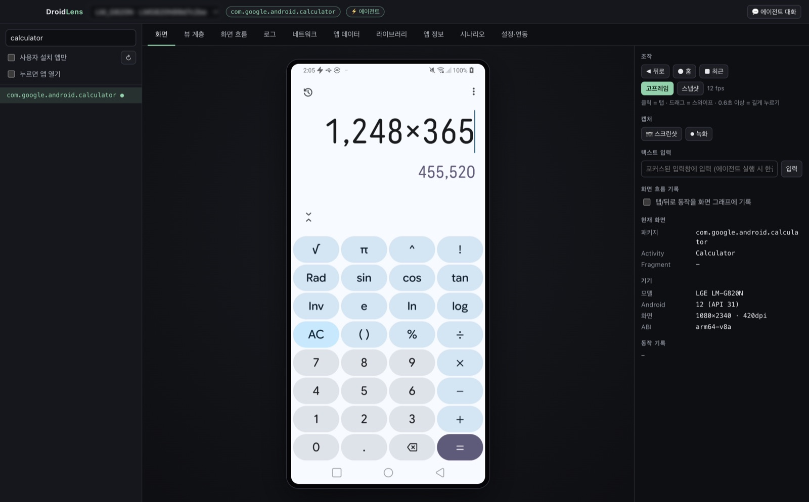
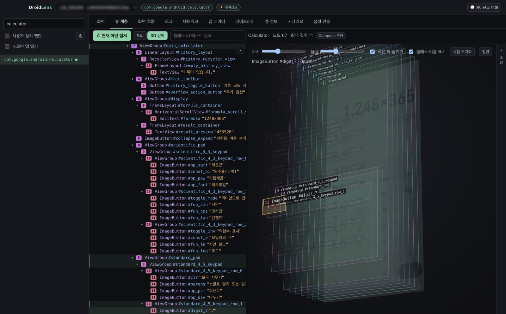
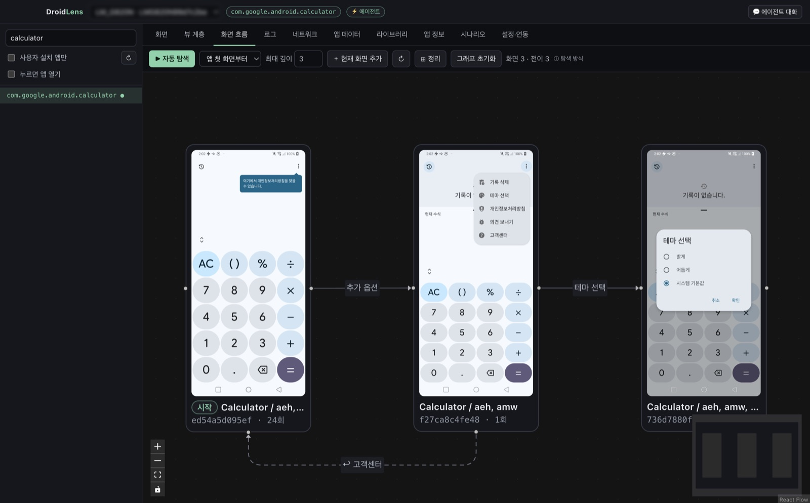
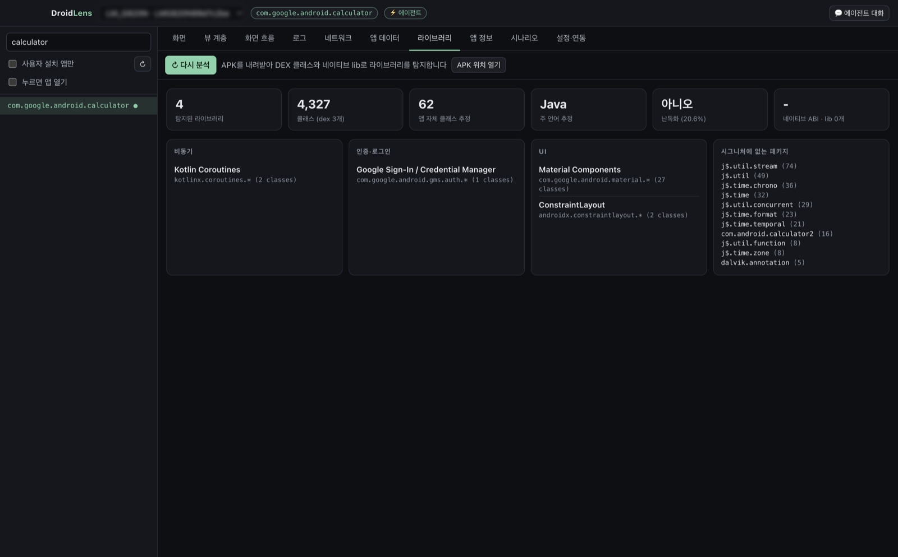
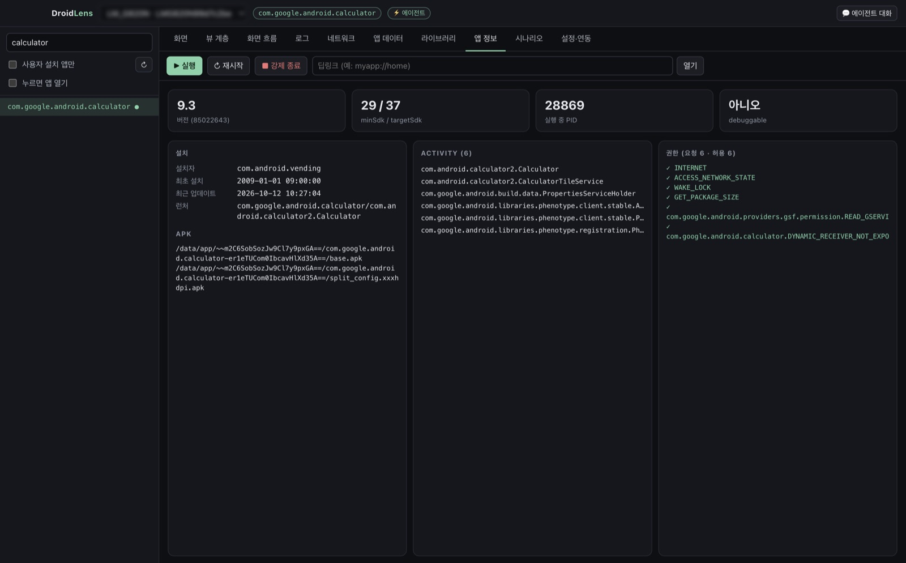

<p align="center"></p>

<h1 align="center">DroidLens</h1>

<p align="center">Android 앱을 들여다보는 렌즈 — 분석 · 디버깅 · 화면 흐름 · 시나리오 검증<br>
SDK 없이 adb만으로 <b>모든 앱</b>을 분석하고, Claude Code 에이전트가 직접 기기를 조작해 검증합니다.</p>

<p align="center"><a href="https://github.com/ESeungJun/droidlens/releases/latest"><b>⬇ 최신 버전 다운로드</b></a></p>

<p align="center"><a href="README.md">English</a> · <b>한국어</b></p>

<p align="center"><a href="docs/video/droidlens-demo.mp4"></a><br>
<sub>▶ <a href="docs/video/droidlens-demo.mp4">원본 화질 영상 보기 (MP4, 28초, 영어)</a></sub></p>

---

Meta의 [Flipper](https://github.com/facebook/flipper)(2025년 아카이브)를 대체하는 것을 목표로 합니다. 앱에 아무것도 심지 않아도 화면 미러링, 뷰 계층, 화면 이동 경로, 사용 라이브러리를 볼 수 있고, 내장 MCP 서버로 Claude Code 에이전트가 같은 기능을 그대로 사용합니다.

## 스크린샷

<p align="center"></p>

<table>
  <tr>
    <td align="center" width="50%"><b>클래스 라벨이 붙은 3D 뷰 계층</b><br></td>
    <td align="center" width="50%"><b>자동 탐색으로 만든 화면 흐름</b><br></td>
  </tr>
  <tr>
    <td align="center"><b>APK 기반 라이브러리 탐지</b><br></td>
    <td align="center"><b>앱 정보</b><br></td>
  </tr>
</table>

## 설치

**macOS · Linux — 터미널 한 줄** (최신 버전으로 설치·업데이트, macOS 에서는 보안 경고 없이 바로 열립니다):
```bash
curl -fsSL https://raw.githubusercontent.com/ESeungJun/droidlens/master/scripts/install.sh | bash
```

또는 [Releases](https://github.com/ESeungJun/droidlens/releases/latest)에서 운영체제에 맞는 **설치 파일 하나만** 받으세요. 나머지(`.zip`, `.mjs`, `.apk`)는 앱 내 업데이트나 부가 도구용이라 받지 않아도 됩니다.

| 운영체제 | 파일 |
| --- | --- |
| macOS (Apple 칩 M1~) | `DroidLens-x.y.z-mac-arm64.dmg` |
| macOS (Intel) | `DroidLens-x.y.z-mac-x64.dmg` |
| Windows (x64) | `DroidLens-x.y.z-win-x64.exe` |
| Windows (ARM) | `DroidLens-x.y.z-win-arm64.exe` |
| Linux | `DroidLens-x.y.z-linux-x86_64.AppImage` |

**macOS 첫 실행 (.dmg 로 받은 경우)**: Apple 서명·공증을 받은 앱이라 응용 프로그램 폴더로 옮긴 뒤 바로 열면 됩니다. (0.8.3 이하는 공증 전 버전이라 **시스템 설정 → 개인정보 보호 및 보안**의 **그래도 열기**나 `xattr -dr com.apple.quarantine /Applications/DroidLens.app` 이 필요합니다.)
**Windows 첫 실행**: SmartScreen 경고가 뜨면 "추가 정보 → 실행"을 누르세요.

**업데이트**: 새 버전이 나오면 상단 바에 **⬆ 업데이트** 버튼이 뜹니다. 누르면 내려받아 교체하고 다시 시작합니다 (**설정** 탭에서도 확인 가능, macOS 로그는 `~/.droidlens/update.log`).

### 준비물: adb
Android Studio가 설치되어 있으면 자동으로 찾습니다. 없다면 platform-tools만 설치하세요.
```
macOS    brew install --cask android-platform-tools
Windows  winget install Google.PlatformTools
Linux    sudo apt install adb
```
그다음 기기에서 **개발자 옵션 → USB 디버깅**을 켜고 연결하거나 에뮬레이터를 실행하면 됩니다. 이 컴퓨터에 만들어 둔 가상 기기(AVD)는 상단 기기 목록에 함께 나오고, 고르면 DroidLens 가 띄워서 부팅이 끝나면 바로 선택합니다(끄기 버튼도 있음). 가상 기기가 없으면 **기기 연결 도우미**가 설치를 안내합니다. adb 경로는 앱의 **설정** 탭에서 직접 지정할 수도 있습니다.

## 기능

| 분류 | 탭 | 내용 |
| --- | --- | --- |
| **화면** | **기기 화면** | 고프레임 미러링 (scrcpy 스트림 + WebCodecs, 최대 60fps) 또는 스냅샷 모드, 클릭 = 탭 · 드래그 = 스와이프 · 길게 = 롱프레스, 하드웨어 키, 텍스트 입력, 스크린샷, 녹화(최대 180초) |
|  | **뷰 계층** | 스크린샷 ↔ 트리 양방향 선택, 속성·셀렉터, 깊이별 노드 수, Compose 추정, **3D 깊이 분해도** |
|  | **화면 흐름** | 앱별 **화면 지도** — 자동 탐색·직접 조작·시나리오 실행에서 지나간 화면과 연결이 한 지도에 계속 쌓임 (썸네일 + 동작 라벨). **자동 탐색**(결제·삭제·로그아웃·전송 버튼은 누르지 않음), 스크린샷에서 **버튼·길게 누르기·스와이프를 골라 그 동작으로 열리는 흐름만 탐색**, 화면별 눌러 본 버튼 수, 첫 화면에서의 경로 강조, 기록된 경로로 **그 화면까지 자동 이동**, 지도 내보내기·가져오기(합치기) |
| **진단** | **로그** | 실시간 logcat (앱 PID 필터, 레벨, 검색), 최근 크래시 |
|  | **네트워크** ¹ | OkHttp 요청·응답 (헤더, 본문 JSON 정렬, 이미지 미리보기, 소요 시간), 실패 필터, cURL 복사, **네트워크 목**(응답·실패·지연) |
|  | **성능** | 실시간 CPU·메모리(PSS, 영역별)·초당 프레임 그래프, 버벅인 프레임 비율과 프레임 시간 백분위, 앱 시작 시간 측정(콜드·다시 열기, 여러 번 반복해 중앙값) |
| **앱** | **앱 데이터** ¹ | SharedPreferences 조회·편집, SQLite/Room DB 브라우저와 SQL 실행, 커스텀 이벤트 |
|  | **앱 정보** | 버전·SDK·권한·Activity, 실행/재시작/종료, 딥링크 |
|  | **라이브러리** | APK의 DEX·네이티브 lib로 100여 개 라이브러리·프레임워크 탐지, 난독화 추정 |
| **테스트** | **시나리오** | 검증 리포트(단계별 스크린샷·판정), **YAML 스크립트** 작성·실행·전체 회귀 실행, 스크린샷 비교 실패 시 지금 화면을 새 기준으로 받아들이기 |
| **설정** | **설정·연동** | adb 경로, Claude Code MCP 원클릭 등록, 전용 에이전트 설치 |
| | **💬 에이전트 대화** | 상단 버튼으로 여는 대화창. 미러링을 보면서 검증·분석 에이전트에게 바로 요청 (이 컴퓨터의 Claude Code 로그인 사용, API 키 불필요) |

¹ 앱 debug 빌드에 [DroidLens SDK](#앱-sdk-선택)가 필요합니다.

## 앱 SDK (선택)

네트워크·저장소처럼 앱 내부에서만 볼 수 있는 정보는 SDK를 넣은 **내 앱의 debug 빌드**에서만 보입니다. release 빌드에는 같은 API의 빈 구현(`sdk-noop`)이 들어갑니다.

```kotlin
// settings.gradle.kts
dependencyResolutionManagement {
    repositories { maven { url = uri("https://jitpack.io") } }
}

// app/build.gradle.kts
dependencies {
    debugImplementation("com.github.ESeungJun.droidlens:sdk:v0.5.0")
    releaseImplementation("com.github.ESeungJun.droidlens:sdk-noop:v0.5.0")
}

// 네트워크 인스펙터 (OkHttp를 쓰는 경우)
// 앱의 다른 인터셉터(공통 파라미터·서명 등) 뒤, 마지막에 추가하길 권장한다 (덧붙인 값까지 기록되고, 뒤 인터셉터가 원래 본문 타입을 그대로 본다)
val client = OkHttpClient.Builder()
    .addInterceptor(DroidLensInterceptor())
    .build()

// 커스텀 이벤트 (선택)
DroidLens.event("purchase_clicked", JSONObject().put("itemId", 42))
```

- 초기화 코드는 필요 없습니다 (ContentProvider로 자동 시작)
- 앱 내부 유닉스 소켓(`localabstract:droidlens_sdk_<패키지>`)으로만 통신하므로 INTERNET 권한이 필요 없고, 접속 UID를 검사해 adb·앱 자신 외의 연결(같은 기기의 다른 앱 등)은 거부합니다
- 요청·응답 본문은 각 256KB까지, 최근 500건을 메모리에만 보관합니다
- 민감 정보는 **기기 안에서 저장하기 전에** 가립니다 — 헤더, URL 쿼리, `Location` 리다이렉트, JSON 본문(중첩 객체·배열, 문자열 안의 JSON 포함), GraphQL 인자, 폼·multipart·XML 본문, 오류 메시지, 커스텀 이벤트. 키는 대소문자·구분자와 상관없이 맞추고, 흔한 단어는 이름에 들어 있기만 해도 가립니다(`newPassword`, `fcmToken`, `X-Refresh-Token`). `jwt`·`otp`·`pin` 같은 짧은 이름은 정확히 같을 때만 가립니다. `DroidLens.redactHeaders("X-Session")`, `DroidLens.redactKeys("phone")` 로 추가하고, `DroidLens.clearDefaultRedaction()` 으로 기본 규칙을 끌 수 있습니다. 앱이 직접 압축을 요청한 본문(`Content-Encoding`)은 기록하지 않습니다
- DB 쓰기 SQL은 명시적으로 허용했을 때만 실행됩니다
- **네트워크 목**: URL에 정한 문자열이 들어 있는 요청을 서버에 보내지 않고 원하는 상태 코드·본문으로 응답하거나, 연결 실패로 끝내거나, 늦춰 보낼 수 있습니다(네트워크 탭의 **목 규칙**, 기록된 요청에서 **목 만들기**). 규칙은 앱 내부 저장소에 남아 앱을 다시 시작해도 적용되고, 켜져 있으면 logcat에 경고가 남습니다

## Claude Code 연동

앱의 **설정** 탭에서 버튼 두 개만 누르면 됩니다.

1. **MCP 자동 등록** — 앱에 내장된 MCP 서버(도구 50개)를 `claude mcp add --scope user`로 등록합니다. Node를 따로 설치할 필요가 없습니다.
2. **에이전트 설치** — 전용 에이전트를 `~/.claude/agents/`에 복사합니다.

| 에이전트 | 하는 일 |
| --- | --- |
| `droidlens-verifier` | 자연어 시나리오를 실제 기기에서 단계별로 검증하고, 스크린샷이 포함된 HTML 리포트를 남깁니다 |
| `droidlens-analyst` | 기술 스택, UI 구조(View/Compose), 화면 지도를 분석합니다. [REA](https://github.com/morluto/rea)가 있으면 코드 수준까지 추적합니다 |

Claude Code를 재시작한 뒤 이렇게 요청하세요.
> droidlens-verifier로 쇼핑 앱에서 검색 → 상품 상세 → 찜하기 시나리오 검증해줘
>
> droidlens-analyst로 이 앱 기술 스택이랑 화면 구조 분석해줘

앱 없이 MCP만 쓰려면 Releases의 `droidlens-mcp.mjs`(Node 20+)를 받아 `claude mcp add --scope user droidlens -- node /path/to/droidlens-mcp.mjs`로 등록하세요.

## 시나리오 스크립트 (회귀 테스트)

검증한 흐름을 YAML로 저장해 언제든 다시 돌릴 수 있습니다. 에이전트가 `droidlens-verifier`로 시나리오를 **통과시키면 조작과 검사가 자동으로 녹화되어** `~/.droidlens/scripts/`에 저장됩니다. 직접 쓰거나 고칠 수도 있습니다.

```yaml
name: 상품 검색
app: com.example.shop
setup: { restart: true }          # clearData, prefs(SDK)로 초기 상태도, mocks(SDK)로 실행 중에만 켤 네트워크 목도 만들 수 있음
steps:
  - tap: { text: 검색 }
  - type: { text: 운동화, into: { className: EditText } }
  - enter                          # 한 단어 축약: back / home / enter / launch / screenshot
  - wait: { id: result_list, timeout: 8000 }
  - swipe: { direction: up, until: { textContains: 에어맥스 } }
  - tap: { textContains: 에어맥스 }
  - assert: { activity: ProductDetailActivity }
  - assert: { network: { url: /api/products, method: GET, status: 200 } }   # SDK
  - assert: { event: product_viewed }                                        # SDK
  - matchScreenshot: { name: 상품 상세, ignore: [ { id: ad_banner } ] }  # 기준 이미지와 비교
  - assert: { perf: { maxMemoryMb: 300, maxJankPercent: 10 } }           # 메모리·버벅인 프레임 상한
  - assert: { noCrash: true }
```

| 단계 | 설명 |
| --- | --- |
| `tap` / `longPress` | 셀렉터(id·text·textContains·desc·descContains·className·index) 요소를 기다렸다가 누름. `optional: true`면 없을 때 건너뜀 |
| `type` | 입력 (`into`로 입력창 지정, `clear`로 교체). 에이전트가 있으면 한글 가능 |
| `swipe` | `up/down/left/right`, `until`이면 요소가 보일 때까지 스크롤 |
| `wait` | 요소가 나타날 때까지 (`gone: true`면 사라질 때까지) |
| `startup` | 앱 시작 시간 측정 (`cold`, `runs`), 중앙값이 `maxMs`를 넘으면 실패 |
| `matchScreenshot` | 화면을 기준 이미지와 픽셀 비교 (`name`, `maxDiffPercent` 기본 0.5, `ignore` 셀렉터, `tolerance` 색 차이 허용치 기본 16). 처음 실행하면 지금 화면이 기준이 되고, 상태바는 비교하지 않습니다. 실패하면 리포트에 달라진 곳을 칠한 이미지와 **지금 화면을 기준으로** 버튼이 붙습니다 |
| `assert` | `visible` · `notVisible` · `text` · `activity` · `package` · `network` · `pref` · `db` · `event` · `perf` · `noCrash` |
| 기타 | `key`, `tapAt`, `sleep`, `launch`, `deeplink`, `screenshot` |

실행 방법:
- 데스크톱 **시나리오 → 스크립트** 탭에서 편집·실행·전체 회귀 실행
- Claude Code: `script_run`, `suite_run`, `script_write`
- CI/터미널: `node droidlens-mcp.mjs run <파일|폴더> [--serial <기기>]` (실패 시 종료 코드 1)

예시는 [examples/scripts](examples/scripts).

## 산출물

모두 `~/.droidlens/`에 저장됩니다 (`DROIDLENS_HOME`으로 변경 가능).

| 폴더 | 내용 |
| --- | --- |
| `screenshots/`, `recordings/` | 스크린샷 PNG, 녹화 mp4 |
| `graphs/<패키지>/` | 앱 화면 지도 `graph.json`, `graph.mmd`(mermaid), 화면별 스크린샷. 화면 흐름 탭의 '내보내기'는 스크린샷을 담은 `*.droidlens-map.json` 한 파일로 저장 |
| `scenarios/<id>/` | 시나리오 검증 `report.html`, `scenario.json`, 녹화된 `script.yaml`, 단계별 스크린샷 |
| `scripts/` | 회귀 테스트 스크립트 (YAML) |
| `apks/<패키지>/` | 분석용 APK |

## 온디바이스 에이전트

기기를 연결하면 DroidLens가 작은 에이전트 앱(`io.github.eseungjun.droidlens.agent`, 13KB)을 자동으로 설치·실행합니다. 상단 바의 **⚡ 에이전트** 표시로 상태를 확인하고 끄고 켤 수 있습니다.

| | 에이전트 없음 (uiautomator) | 에이전트 |
| --- | --- | --- |
| 뷰 계층 덤프 | 1.5~3초 | 0.03~0.3초 |
| 현재 Activity | dumpsys 1~7초 | 즉시 (접근성 이벤트 추적) |
| 텍스트 입력 | ASCII만 | 한글 등 유니코드 |
| 화면 안정 판정 | 스크린샷 비교 | 접근성 idle + 구조 비교 |

에이전트는 UI 테스트 도구(Appium, uiautomator)와 같은 Instrumentation 권한으로 동작합니다. 네트워크를 열지 않고 기기 내부 유닉스 소켓만 쓰며, **adb를 거친 연결만** 받습니다 (접속 UID 검사). 쓰지 않으려면 `DROIDLENS_AGENT=0`.

## 알려진 한계

- 네트워크·DB·SharedPreferences는 SDK를 넣은 debug 빌드에서만 (타사 앱은 불가)
- 네트워크 인스펙터는 OkHttp(Retrofit 포함) 기반 요청만 기록
- WebView·Flutter·게임 엔진 화면은 접근성 노드가 적어 분석이 제한적
- Appium 등 다른 UiAutomation 도구와 동시에 쓸 수 없음 (상단 바에서 에이전트를 끄면 됨)

## 개발

```bash
pnpm install
pnpm build                              # core + mcp
pnpm dev                                # 데스크톱 앱 (개발 모드)
pnpm build:agent                        # 에이전트 APK (JDK 17 + Android SDK 필요)
pnpm dist                               # 현재 OS용 설치 파일 → apps/desktop/release/
```

```
packages/core     adb 엔진 (기기·입력·캡처, 뷰 계층, 화면 그래프·자동 탐색, 라이브러리 탐지, 시나리오)
packages/mcp      MCP 서버 (단일 파일 번들 droidlens-mcp.mjs)
android/agent     온디바이스 에이전트 APK (Instrumentation + HTTP)
android/sdk       앱 SDK (네트워크·Prefs·DB·이벤트), sdk-noop, sample
apps/desktop      Electron + React
agents/           Claude Code 에이전트 정의
```

### 브랜치 (git flow)

| 브랜치 | 용도 |
| --- | --- |
| `master` | 배포된 코드만. 모든 커밋이 태그(`v*`)가 붙은 릴리스 |
| `develop` | 다음 릴리스를 모으는 통합 브랜치. 기능 PR은 여기로 |
| `feature/<이름>` | 기능·수정 작업. `develop`에서 따서 PR로 다시 합침 |
| `release/<버전>` | 릴리스 준비(버전 올리기·노트). `develop`에서 따서 `master`·`develop`에 합친 뒤 태그 |
| `hotfix/<버전>` | 긴급 수정. `master`에서 따서 `master`·`develop`에 합친 뒤 태그 |
| `docs/<이름>` | README·문서만 바꾸는 변경(앱 코드 없음). `master`에서 따서 `master`·`develop`에 합치고 릴리스·태그는 하지 않음 |

### 커밋 메시지

모든 커밋과 PR 제목(머지 커밋 제목이 됨)은 [Conventional Commits](https://www.conventionalcommits.org) 형식을 씁니다: `<type>(<scope>)?: <설명>`.

| type | 용도 |
| --- | --- |
| `feat` | 새 기능 |
| `fix` | 버그 수정 |
| `docs` | 문서만 변경 |
| `refactor` / `perf` / `style` | 동작 변화 없는 코드 개선 / 성능 / 서식 |
| `test` | 테스트 |
| `build` / `ci` | 패키징·의존성 / GitHub Actions |
| `chore` | 버전, 머지, 기타 관리 |

`pnpm install` 하면 프리픽스 없는 커밋을 막는 `commit-msg` 훅(`.githooks/`)이 설치되고, CI가 push된 커밋과 PR 제목을 검사합니다.

`v*` 태그를 푸시하면 GitHub Actions가 macOS(arm64/x64)·Windows(x64/arm64)·Linux 설치 파일을 빌드해 Releases에 올립니다. 로드맵은 [docs/ROADMAP.md](docs/ROADMAP.md).

## 라이선스

MIT. 고프레임 미러링에 [scrcpy](https://github.com/Genymobile/scrcpy) 서버(Apache-2.0)를 내려받아 함께 배포합니다 (`scripts/fetch-scrcpy.mjs`, SHA256 검증).
