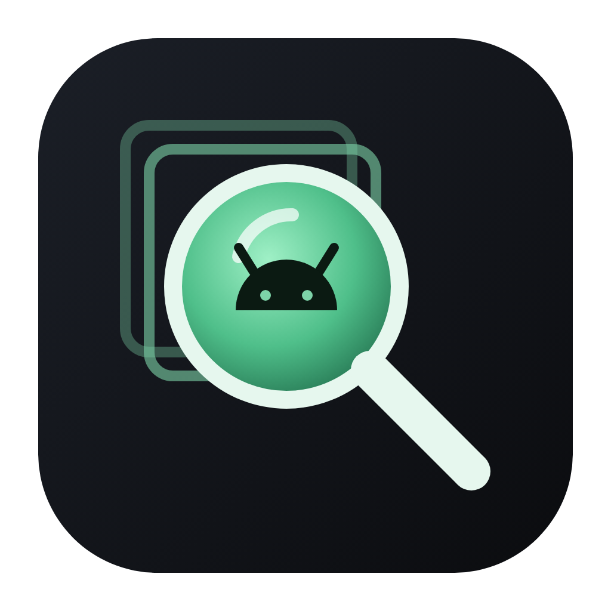
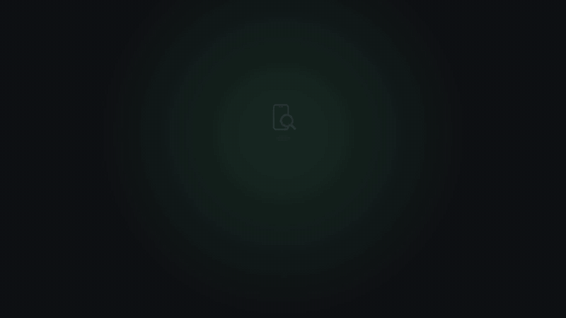
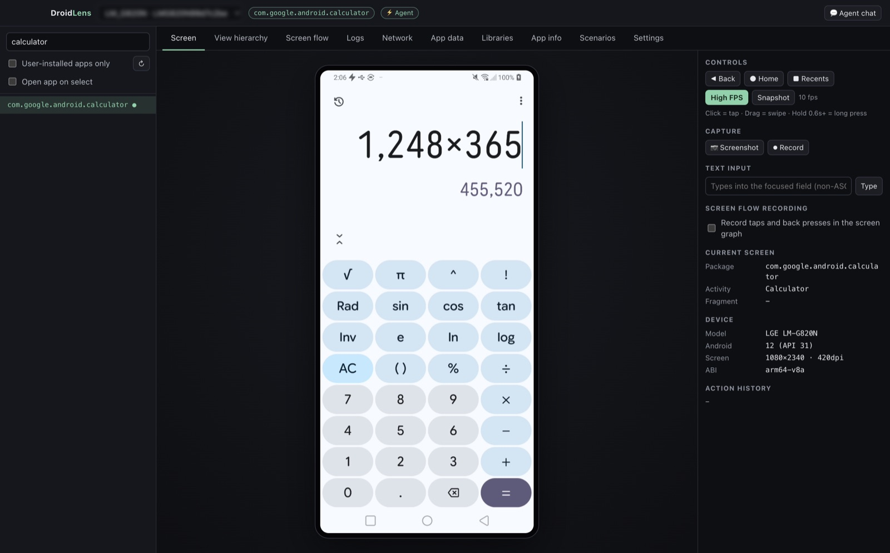
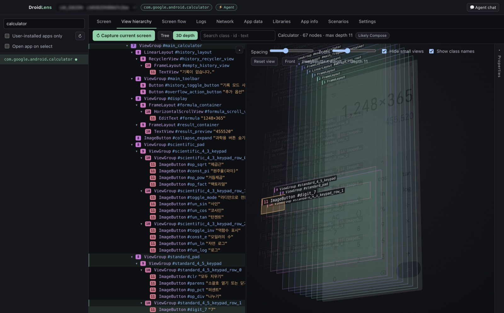
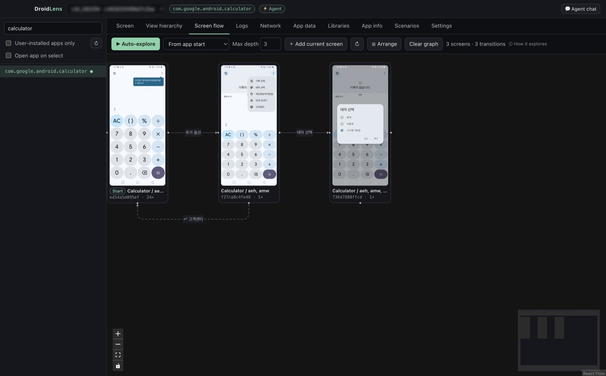
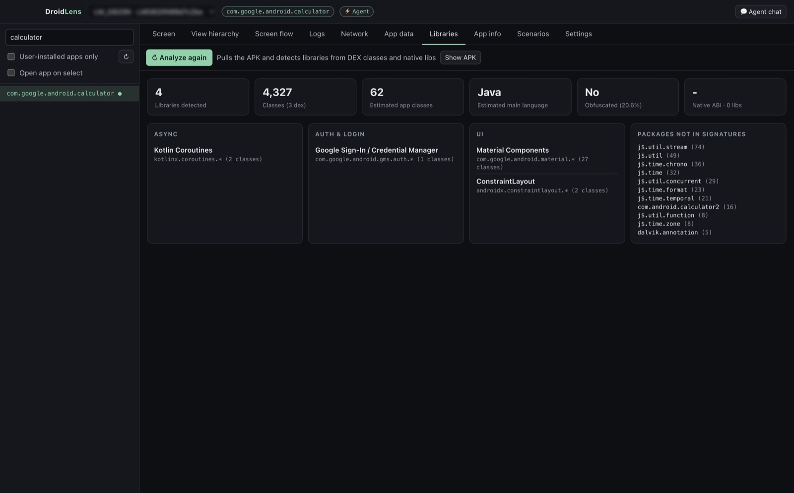
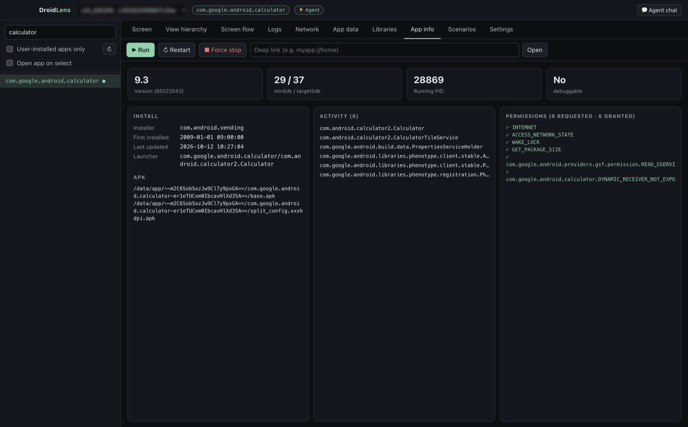

<p align="center"></p>

<h1 align="center">DroidLens</h1>

<p align="center">A lens into Android apps — analysis · debugging · screen flows · scenario verification<br>
Inspect <b>any app</b> with just adb, no SDK required, and let Claude Code agents drive the device to verify it.</p>

<p align="center"><a href="https://github.com/ESeungJun/droidlens/releases/latest"><b>⬇ Download the latest release</b></a></p>

<p align="center"><b>English</b> · <a href="README.ko.md">한국어</a></p>

<p align="center"><a href="docs/video/droidlens-demo.mp4"></a><br>
<sub>▶ <a href="docs/video/droidlens-demo.mp4">Watch the full-quality video (MP4, 28s)</a></sub></p>

---

DroidLens aims to replace Meta's [Flipper](https://github.com/facebook/flipper) (archived in 2025). Without adding anything to your app, you get screen mirroring, the view hierarchy, screen navigation paths, and the libraries an app uses — and the built-in MCP server lets Claude Code agents use the same features.

## Screenshots

<p align="center"></p>

<table>
  <tr>
    <td align="center" width="50%"><b>3D view hierarchy with class labels</b><br></td>
    <td align="center" width="50%"><b>Screen flow from auto-exploration</b><br></td>
  </tr>
  <tr>
    <td align="center"><b>Library detection from the APK</b><br></td>
    <td align="center"><b>App info</b><br></td>
  </tr>
</table>

## Installation

**macOS · Linux — one line in Terminal** (installs or updates to the latest version; on macOS it opens without any Gatekeeper warning):
```bash
curl -fsSL https://raw.githubusercontent.com/ESeungJun/droidlens/master/scripts/install.sh | bash
```

Or download **just one installer** for your OS from [Releases](https://github.com/ESeungJun/droidlens/releases/latest). The other files (`.zip`, `.mjs`, `.apk`) are used by in-app updates or optional tools — you don't need them.

| OS | File |
| --- | --- |
| macOS (Apple silicon, M1+) | `DroidLens-x.y.z-mac-arm64.dmg` |
| macOS (Intel) | `DroidLens-x.y.z-mac-x64.dmg` |
| Windows (x64) | `DroidLens-x.y.z-win-x64.exe` |
| Windows (ARM) | `DroidLens-x.y.z-win-arm64.exe` |
| Linux | `DroidLens-x.y.z-linux-x86_64.AppImage` |

**First launch on macOS (downloaded .dmg)**: the app is signed and notarized by Apple, so just move it to Applications and open it. (0.8.3 and older weren't notarized and need **Open Anyway** in **System Settings → Privacy & Security** or `xattr -dr com.apple.quarantine /Applications/DroidLens.app`.)
**First launch on Windows**: if SmartScreen warns you, click "More info → Run anyway".

**Updates**: when a new version is out, an **⬆ Update** button appears in the top bar. Click it to download, replace, and restart (you can also check from the **Settings** tab; the macOS log is at `~/.droidlens/update.log`).

### Prerequisite: adb
If Android Studio is installed, adb is found automatically. Otherwise, install just the platform-tools:
```
macOS    brew install --cask android-platform-tools
Windows  winget install Google.PlatformTools
Linux    sudo apt install adb
```
Then enable **Developer options → USB debugging** on your device and connect it, or start an emulator. Virtual devices (AVDs) on this computer appear in the device list at the top; pick one and DroidLens starts it and selects it once it has booted (there is a stop button too). If you have none, the **device setup helper** walks you through installing one. You can also set the adb path manually in the app's **Settings** tab.

## Features

| Group | Tab | What it does |
| --- | --- | --- |
| **Screen** | **Device screen** | High-frame-rate mirroring (scrcpy stream + WebCodecs, up to 60fps) or snapshot mode; click = tap · drag = swipe · hold = long press; hardware keys, text input, screenshots, recording (up to 180s) |
|  | **View hierarchy** | Two-way selection between screenshot and tree, attributes and selectors, node count by depth, Compose detection, **3D exploded view** |
|  | **Screen flow** | A per-app **screen map** — screens and transitions from auto-exploration, manual use, and scenario runs keep adding up in one map (thumbnails + action labels). **Auto-exploration** (never taps payment, delete, logout, or send buttons), **pick buttons, long presses, or swipes on a screenshot and explore only the flows they open**, tapped-button coverage per screen, path from the first screen, **auto-navigate to a screen** along the recorded path, map export/import (merge) |
| **Diagnose** | **Logs** | Live logcat (app PID filter, level, search), recent crashes |
|  | **Network** ¹ | OkHttp requests and responses (headers, pretty-printed JSON bodies, image preview, timing), failure filter, copy as cURL, **network mocking** (response, failure, delay) |
|  | **Performance** | Live CPU, memory (PSS, by region) and frames-per-second graphs, janky-frame ratio and frame-time percentiles, app startup time (cold or reopen, repeated runs with the median) |
| **App** | **App data** ¹ | View and edit SharedPreferences, SQLite/Room DB browser with SQL execution, custom events |
|  | **App info** | Version, SDK, permissions, activities; launch / restart / kill; deep links |
|  | **Libraries** | Detects 100+ libraries and frameworks from the APK's DEX and native libs, estimates obfuscation |
| **Test** | **Scenarios** | Verification reports (per-step screenshots and verdicts), write and run **YAML scripts**, run the full regression suite, accept the current screen as the new baseline when a screenshot comparison fails |
| **Settings** | **Settings & Integrations** | adb path, one-click Claude Code MCP registration, install bundled agents |
| | **💬 Agent chat** | Chat panel opened from the top bar. Ask the verifier or analyst agent while watching the mirror (uses this computer's Claude Code login — no API key needed) |

¹ Requires the [DroidLens SDK](#app-sdk-optional) in your app's debug build.

## App SDK (optional)

Information that only lives inside the app — network traffic, storage — is visible only in **your own app's debug build** with the SDK added. Release builds get a no-op implementation of the same API (`sdk-noop`).

```kotlin
// settings.gradle.kts
dependencyResolutionManagement {
    repositories { maven { url = uri("https://jitpack.io") } }
}

// app/build.gradle.kts
dependencies {
    debugImplementation("com.github.ESeungJun.droidlens:sdk:v0.5.0")
    releaseImplementation("com.github.ESeungJun.droidlens:sdk-noop:v0.5.0")
}

// Network inspector (if you use OkHttp)
// Add it last, after your other interceptors (common params, signing, ...) so added values are recorded and later interceptors see the original body type
val client = OkHttpClient.Builder()
    .addInterceptor(DroidLensInterceptor())
    .build()

// Custom events (optional)
DroidLens.event("purchase_clicked", JSONObject().put("itemId", 42))
```

- No initialization code needed (starts automatically via a ContentProvider)
- Communicates only over an in-app Unix socket (`localabstract:droidlens_sdk_<package>`), so no INTERNET permission is required; it checks the peer UID and rejects any connection other than adb and the app itself (e.g. other apps on the same device)
- Request and response bodies are capped at 256KB each; the latest 500 entries are kept in memory only
- Sensitive values are masked **on the device, before they are stored** — in headers, URL queries, `Location` redirects, JSON bodies (including nested objects/arrays and JSON inside strings), GraphQL arguments, form, multipart and XML bodies, error messages and custom events. Keys match regardless of case and separators, and common words match anywhere in the name (`newPassword`, `fcmToken`, `X-Refresh-Token`); short ones like `jwt`, `otp`, `pin` match exactly. Add your own with `DroidLens.redactHeaders("X-Session")` / `DroidLens.redactKeys("phone")`, or call `DroidLens.clearDefaultRedaction()` to use only your list. Compressed bodies the app requested itself (`Content-Encoding`) are not recorded
- DB write SQL runs only when explicitly allowed
- **Network mocking**: requests whose URL contains a given string can be answered with any status code and body without reaching the server, failed as a connection error, or delayed (**Mock rules** in the Network tab, or **Mock this** on a recorded request). Rules are kept in the app's private storage and survive restarts; while any are on, a warning is written to logcat

## Claude Code integration

Just press two buttons in the app's **Settings** tab.

1. **Register MCP** — registers the app's built-in MCP server (50 tools) with `claude mcp add --scope user`. No separate Node install needed.
2. **Install agents** — copies the bundled agents to `~/.claude/agents/`.

| Agent | What it does |
| --- | --- |
| `droidlens-verifier` | Verifies natural-language scenarios step by step on a real device and leaves an HTML report with screenshots |
| `droidlens-analyst` | Analyzes the tech stack, UI structure (View/Compose), and screen map. With [REA](https://github.com/morluto/rea) installed, it traces down to the code level |

Restart Claude Code, then ask:
> Use droidlens-verifier to verify the search → product detail → add to wishlist scenario in the shopping app
>
> Use droidlens-analyst to analyze this app's tech stack and screen structure

To use only the MCP server without the app, download `droidlens-mcp.mjs` (Node 20+) from Releases and register it with `claude mcp add --scope user droidlens -- node /path/to/droidlens-mcp.mjs`.

## Scenario scripts (regression tests)

Save verified flows as YAML and replay them anytime. When an agent **passes** a scenario with `droidlens-verifier`, its actions and checks are **recorded automatically** and saved to `~/.droidlens/scripts/`. You can also write or edit scripts by hand.

```yaml
name: Product search
app: com.example.shop
setup: { restart: true }          # clearData and prefs (SDK) can also set up the initial state, and mocks (SDK) for network mocks that stay on only during the run
steps:
  - tap: { text: Search }
  - type: { text: sneakers, into: { className: EditText } }
  - enter                          # one-word shorthands: back / home / enter / launch / screenshot
  - wait: { id: result_list, timeout: 8000 }
  - swipe: { direction: up, until: { textContains: Air Max } }
  - tap: { textContains: Air Max }
  - assert: { activity: ProductDetailActivity }
  - assert: { network: { url: /api/products, method: GET, status: 200 } }   # SDK
  - assert: { event: product_viewed }                                        # SDK
  - matchScreenshot: { name: product-detail, ignore: [ { id: ad_banner } ] }  # compare with a baseline image
  - assert: { perf: { maxMemoryMb: 300, maxJankPercent: 10 } }           # memory / janky-frame limits
  - assert: { noCrash: true }
```

| Step | Description |
| --- | --- |
| `tap` / `longPress` | Waits for the element matching a selector (id · text · textContains · desc · descContains · className · index), then presses it. With `optional: true`, skipped if absent |
| `type` | Text input (`into` targets an input field, `clear` replaces). Supports non-ASCII text (e.g. Korean) when the agent is running |
| `swipe` | `up/down/left/right`; with `until`, scrolls until the element appears |
| `wait` | Until an element appears (with `gone: true`, until it disappears) |
| `startup` | Measures app startup time (`cold`, `runs`); fails if the median exceeds `maxMs` |
| `matchScreenshot` | Pixel-compares the screen with a baseline image (`name`, `maxDiffPercent` default 0.5, `ignore` selectors, `tolerance` per-channel color tolerance, default 16). The first run saves the current screen as the baseline; the status bar is never compared. On failure the report shows the differences highlighted and a **Use as baseline** button |
| `assert` | `visible` · `notVisible` · `text` · `activity` · `package` · `network` · `pref` · `db` · `event` · `perf` · `noCrash` |
| Other | `key`, `tapAt`, `sleep`, `launch`, `deeplink`, `screenshot` |

How to run:
- Desktop: **Scenarios → Scripts** tab to edit, run, and run the full regression suite
- Claude Code: `script_run`, `suite_run`, `script_write`
- CI/terminal: `node droidlens-mcp.mjs run <file|folder> [--serial <device>]` (exit code 1 on failure)

See [examples/scripts](examples/scripts) for examples.

## Outputs

Everything is saved under `~/.droidlens/` (override with `DROIDLENS_HOME`).

| Folder | Contents |
| --- | --- |
| `screenshots/`, `recordings/` | Screenshot PNGs, recorded mp4s |
| `graphs/<package>/` | App screen map `graph.json`, `graph.mmd` (mermaid), per-screen screenshots. 'Export' in the Screen flow tab saves a single `*.droidlens-map.json` with screenshots |
| `scenarios/<id>/` | Scenario verification `report.html`, `scenario.json`, recorded `script.yaml`, per-step screenshots |
| `scripts/` | Regression test scripts (YAML) |
| `apks/<package>/` | APKs pulled for analysis |

## On-device agent

When a device is connected, DroidLens automatically installs and starts a small agent app (`io.github.eseungjun.droidlens.agent`, 13KB). Check its status and toggle it with the **⚡ Agent** indicator in the top bar.

| | Without agent (uiautomator) | With agent |
| --- | --- | --- |
| View hierarchy dump | 1.5–3s | 0.03–0.3s |
| Current activity | dumpsys, 1–7s | Instant (accessibility event tracking) |
| Text input | ASCII only | Unicode (Korean, etc.) |
| Screen idle detection | Screenshot diff | Accessibility idle + structure diff |

The agent runs with the same Instrumentation privileges as UI testing tools (Appium, uiautomator). It opens no network ports, uses only an on-device Unix socket, and accepts **only connections that come through adb** (peer UID check). To disable it, set `DROIDLENS_AGENT=0`.

## Known limitations

- Network, DB, and SharedPreferences work only in debug builds with the SDK (not available for third-party apps)
- The network inspector records only OkHttp-based requests (including Retrofit)
- WebView, Flutter, and game-engine screens expose few accessibility nodes, so analysis is limited
- Can't run alongside other UiAutomation tools such as Appium (turn off the agent from the top bar)

## Development

```bash
pnpm install
pnpm build                              # core + mcp
pnpm dev                                # desktop app (dev mode)
pnpm build:agent                        # agent APK (requires JDK 17 + Android SDK)
pnpm dist                               # installer for the current OS → apps/desktop/release/
```

```
packages/core     adb engine (device, input, capture, view hierarchy, screen graph & auto-exploration, library detection, scenarios)
packages/mcp      MCP server (single-file bundle droidlens-mcp.mjs)
android/agent     on-device agent APK (Instrumentation + HTTP)
android/sdk       app SDK (network, prefs, DB, events), sdk-noop, sample
apps/desktop      Electron + React
agents/           Claude Code agent definitions
```

### Branches (git flow)

| Branch | Purpose |
| --- | --- |
| `master` | Released code only. Every commit here is a tagged release (`v*`) |
| `develop` | Integration branch for the next release. Open feature PRs against this |
| `feature/<name>` | New features and fixes, branched from `develop` and merged back via PR |
| `release/<version>` | Release prep (version bump, notes) from `develop`; merged into `master` and `develop`, then tagged |
| `hotfix/<version>` | Urgent fixes from `master`; merged into `master` and `develop`, then tagged |
| `docs/<name>` | README and docs only (no app code), from `master`; merged into `master` and `develop` with no release or tag |

### Commit messages

Every commit (and PR title, which becomes the merge commit title) uses [Conventional Commits](https://www.conventionalcommits.org): `<type>(<scope>)?: <description>`.

| Type | Use for |
| --- | --- |
| `feat` | New feature |
| `fix` | Bug fix |
| `docs` | Documentation only |
| `refactor` / `perf` / `style` | Code change without behavior change / performance / formatting |
| `test` | Tests |
| `build` / `ci` | Packaging, dependencies / GitHub Actions |
| `chore` | Versions, merges, other maintenance |

`pnpm install` installs a `commit-msg` hook (`.githooks/`) that rejects commits without a prefix, and CI checks pushed commits and PR titles.

Pushing a `v*` tag makes GitHub Actions build installers for macOS (arm64/x64), Windows (x64/arm64), and Linux and upload them to Releases. See the roadmap in [docs/ROADMAP.md](docs/ROADMAP.md).

## License

MIT. For high-frame-rate mirroring, the [scrcpy](https://github.com/Genymobile/scrcpy) server (Apache-2.0) is downloaded and bundled (`scripts/fetch-scrcpy.mjs`, SHA256-verified).
