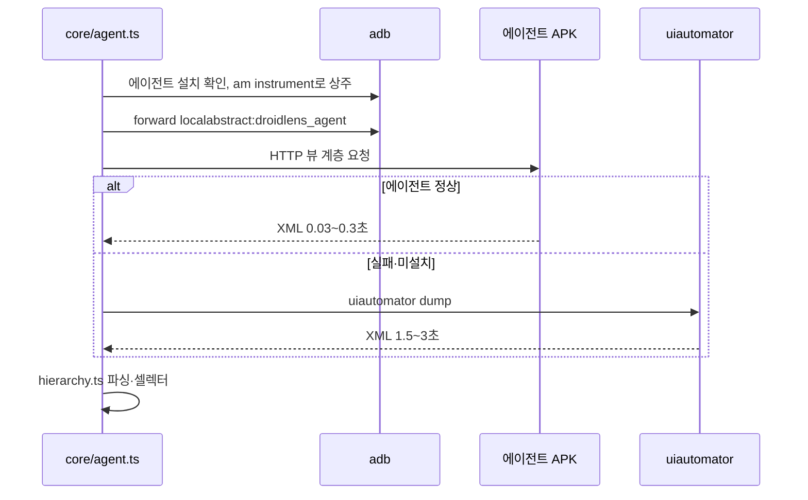
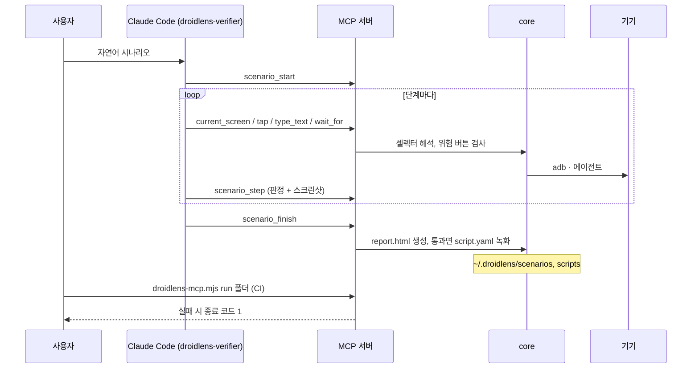
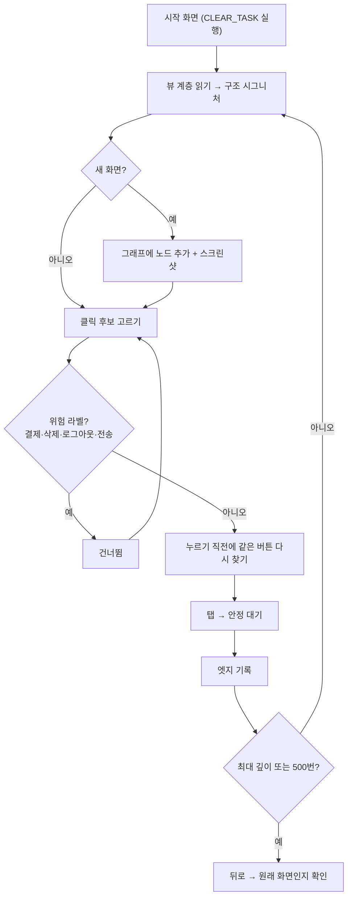
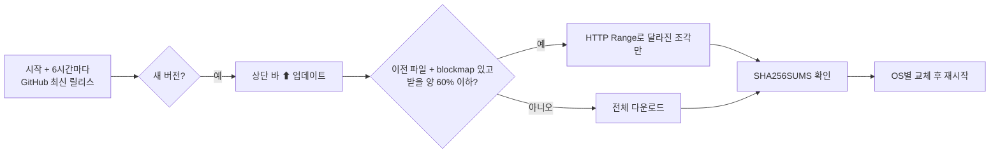

# DroidLens 구현도

> 2026-11-05에 v0.10.4 코드에서 복원했다.

관련 문서: [기획서](기획서.md) · [설계서](설계서.md) · [결정기록](결정기록.md) · [로드맵](ROADMAP.md)

## 폴더·모듈 구조

```
droidlens/
├─ packages/
│  ├─ core/src/              adb 엔진 (@droidlens/core)
│  │  ├─ adb.ts              adb 찾기·실행, 기기 셸·forward
│  │  ├─ device.ts           기기 정보, 입력, 스크린샷·녹화
│  │  ├─ agent.ts            온디바이스 에이전트 설치·상주·재확인, 실패 시 uiautomator 대체
│  │  ├─ hierarchy.ts        뷰 계층 파싱·셀렉터·통계·압축 텍스트
│  │  ├─ graph.ts            화면 그래프 저장, 자동 탐색, 경로 재생, 위험 버튼 회피
│  │  ├─ graph-model.ts      그래프 공용 계산(렌더러에서도 사용)
│  │  ├─ libraries.ts        DEX type_ids 파싱 + 시그니처 103개로 라이브러리 탐지
│  │  ├─ scenario.ts         시나리오 기록·HTML 리포트
│  │  ├─ scenario-view.ts    리포트 표시 모델(HTML·데스크톱 공용, 브라우저용 순수 모듈)
│  │  ├─ redact.ts           리포트 문구의 비밀값 가리기
│  │  ├─ script.ts           YAML 스크립트 파싱·실행·회귀 실행
│  │  ├─ visual.ts           스크린샷 비교
│  │  ├─ perf.ts             시작 시간·CPU·메모리·프레임
│  │  ├─ sdk.ts              SDK 소켓 찾기·포워딩·클라이언트
│  │  ├─ scrcpy.ts           scrcpy 서버 실행·패킷 파싱
│  │  ├─ emulator.ts         AVD 목록·실행·종료
│  │  ├─ app.ts              앱 목록·정보·실행·딥링크
│  │  ├─ http.ts             공용 로컬 HTTP 클라이언트
│  │  ├─ image.ts            이미지 처리
│  │  └─ workspace.ts        ~/.droidlens 경로·원자적 쓰기
│  └─ mcp/src/               MCP 서버 (@droidlens/mcp → droidlens-mcp.mjs)
│     ├─ index.ts            stdio 서버, `run` CLI(회귀 실행)
│     ├─ common.ts           셀렉터 해석(resolveNode) 등 공용
│     └─ tools/              device · screen · input · app · graph · sdk · scenario · perf (도구 50개)
├─ apps/desktop/             Electron + React 데스크톱 (@droidlens/desktop)
│  ├─ src/main/index.ts      메인 프로세스, IPC, 창, 프로세스 정리
│  ├─ src/main/chat.ts       에이전트 대화창(claude -p 헤드리스, stream-json)
│  ├─ src/main/updater.ts    업데이트 확인·다운로드·교체
│  ├─ src/main/delta.ts      blockmap으로 달라진 조각만 받기
│  ├─ src/preload/index.ts   렌더러에 여는 IPC 채널
│  ├─ src/renderer/src/      App.tsx, MirrorCanvas(WebCodecs), ChatPanel, DeviceSetup, Updater, i18n, theme
│  │  └─ tabs/               Screen · Inspector · Flow · Log · Network(+Mocks) · Perf · AppData · AppInfo · Libs · Scenarios(+Scripts) · Settings
│  └─ electron-builder.yml   패키징(MCP 번들·에이전트 APK·scrcpy·에이전트 정의 포함)
├─ android/
│  ├─ agent/                 온디바이스 에이전트(AgentInstrumentation · AgentServer · ActivityTracker)
│  ├─ sdk/                   앱 SDK(DroidLens · DroidLensInterceptor · InitProvider, internal/ 저장소·Redactor·SdkServer)
│  ├─ sdk-noop/              release용 빈 구현
│  └─ sample/                검증용 앱
├─ agents/                   Claude Code 에이전트 정의(droidlens-verifier, droidlens-analyst)
├─ examples/scripts/         예시 YAML
├─ scripts/                  install.sh(한 줄 설치), fetch-scrcpy.mjs, blockmaps.mjs, 아이콘 도구
├─ .githooks/commit-msg      Conventional Commits 검사
├─ .github/workflows/        ci.yml · commit-convention.yml · release.yml
└─ docs/                     ROADMAP.md, 이미지·영상, 이 문서들
```

핵심 파일 링크: [packages/core/src/agent.ts](../packages/core/src/agent.ts) · [packages/core/src/graph.ts](../packages/core/src/graph.ts) · [packages/core/src/script.ts](../packages/core/src/script.ts) · [packages/mcp/src/index.ts](../packages/mcp/src/index.ts) · [apps/desktop/src/main/index.ts](../apps/desktop/src/main/index.ts) · [apps/desktop/src/main/updater.ts](../apps/desktop/src/main/updater.ts) · [android/sdk/src/main/java/io/github/eseungjun/droidlens/sdk/internal/Redactor.java](../android/sdk/src/main/java/io/github/eseungjun/droidlens/sdk/internal/Redactor.java) · [release.yml](../.github/workflows/release.yml)

## 주요 흐름

### 1. 화면 읽기 (에이전트 우선, 실패 시 대체)



### 2. 에이전트 검증 → 스크립트 → 회귀



### 3. 자동 탐색



### 4. 업데이트



## 빌드·실행·배포

```bash
pnpm install          # .githooks 커밋 훅도 설정
pnpm build            # core + mcp
pnpm dev              # 데스크톱 앱 개발 모드 (scrcpy 서버도 받음)
pnpm build:agent      # 에이전트 APK (JDK 17 + Android SDK)
pnpm dist             # 현재 OS용 설치 파일 → apps/desktop/release/
pnpm mcp              # MCP 서버 직접 실행
pnpm typecheck
```

- UI 확인: `DROIDLENS_OPEN="tab=..&pkg=.." DROIDLENS_SNAPSHOT=<png>`로 자체 캡처(프로젝트 메모리). 띄운 개발 빌드는 반드시 끈다.
- 에이전트를 끄려면 `DROIDLENS_AGENT=0`.
- CI(`ci.yml`): master·develop push와 PR에서 빌드, 에이전트·SDK·샘플 APK, 데스크톱 타입 검사·빌드. Gradle 배포판·의존성은 `setup-java`의 `cache: gradle`로 캐시하고, Gradle 단계는 실패하면 두 번까지 다시 시도한다.
- 커밋 규칙(`commit-convention.yml`): push된 커밋과 PR 제목이 Conventional Commits인지 검사.
- 릴리스(`release.yml`): `v*` 태그 푸시 → macOS(서명·공증)·Windows·Linux 빌드 → 설치 파일, zip, blockmap, `droidlens-mcp.mjs`, 에이전트 APK, SHA256SUMS를 Releases에 올림. 릴리스는 초안으로 먼저 만들고 파일을 다 올린 뒤 공개한다. GitHub API 호출은 실패하면 네 번까지 다시 시도하고, 노트 자동 생성 API가 안 되면 이전 태그부터의 커밋 제목으로 노트를 만든다.
- 브랜치(git flow, README): `develop`에서 `feature/…`(실제로는 `feat/…`·`fix/…`) → develop PR, `release/<버전>` → master, `hotfix/<버전>` → master, 이후 master를 develop에 병합. 문서만 바꿀 때는 `docs/<이름>`.

## 버전·릴리스 현황

| 태그 | 날짜 | 주요 내용 |
|---|---|---|
| v0.1.0 | 2026-10-14 | adb 코어, MCP 도구 28개, 데스크톱, 에이전트 2종, 온디바이스 에이전트 APK, 세 OS 설치 파일 |
| v0.2.0 | 2026-10-14 | 선택형 SDK(네트워크·Prefs·DB·이벤트), JitPack |
| v0.3.0 | 2026-10-14 | scrcpy 고프레임 미러링 |
| v0.4.0 | 2026-10-14 | 보안·구조 리뷰 반영, YAML 스크립트·회귀 실행 |
| v0.4.1 | 2026-10-14 | 앱 안 에이전트 대화창 |
| v0.4.2 | 2026-10-14 | 앱 안 자동 업데이트 |
| v0.4.3 | 2026-10-14 | macOS 업데이트 로그 |
| v0.4.4 | 2026-10-14 | git flow 전환(main → master·develop) 뒤 첫 릴리스 브랜치, 아이콘 교체, README 영어·한국어 분리 |
| v0.5.0 | 2026-10-14 | 다국어, 뷰 계층·흐름 개선, 기기 연결 도우미, SDK 민감 정보 가리기, 임시 서명, 한 줄 설치 |
| v0.5.1 | 2026-10-14 | 핫픽스: GitHub API 한도 대응 |
| v0.5.2 | 2026-10-15 | 업데이트 뒤 테스트 환경 변수 차단, Windows claude 인자 |
| v0.6.0 | 2026-10-15 | 앱별 화면 지도 누적, 지정 동작 탐색 |
| v0.7.0 | 2026-10-15 | AVD 실행·종료, 탭 앱 화면 구분 |
| v0.8.0 | 2026-10-16 | 라이트·다크 테마 |
| v0.8.1~0.8.3 | 2026-10-21~22 | 흐름 기록·다중 디스플레이·WebView 탐색 수정 |
| v0.8.4 | 2026-10-22 | macOS Developer ID 서명 + 공증 |
| v0.9.0 | 2026-10-30 | 버그·성능·보안 일괄 수정, 에이전트 버전 4 |
| v0.10.0 | 2026-10-30 | 성능 지표, 네트워크 목, 스크린샷 비교 |
| v0.10.1 | 2026-10-30 | 탭을 대분류·소분류로 |
| v0.10.2 | 2026-10-30 | 조각 업데이트, 흐름 카드 되돌리기 |
| v0.10.3 | 2026-10-30 | 설정을 '설정' 탭으로 |
| v0.10.4 | 2026-11-04 | MCP `tap`이 위험 버튼을 기본으로 누르지 않게 |
| v0.10.5 | 2026-11-06 | MCP `script_run`·`suite_run`도 위험 버튼 단계를 기본으로 누르지 않게 |
| v0.11.0 | 2026-11-06 | 안정된 화면 스샷, 결론 먼저 보이는 시나리오 리포트, 조작 로그·비밀값 가리기, 라이브러리 분석 탭 전환 유지 |

## 앞으로 할 일

[ROADMAP](ROADMAP.md)의 미완료 항목이 기준이다.

- scrcpy 컨트롤 소켓·오디오
- SDK: DataStore, Compose recomposition
- 자동 탐색: 스크롤 영역, 입력 폼 더미 값, 로그인 프리셋
- 결과 대시보드, 스크립트 매개변수
- 버전 간 비교(라이브러리·화면 그래프, REA 연동)
