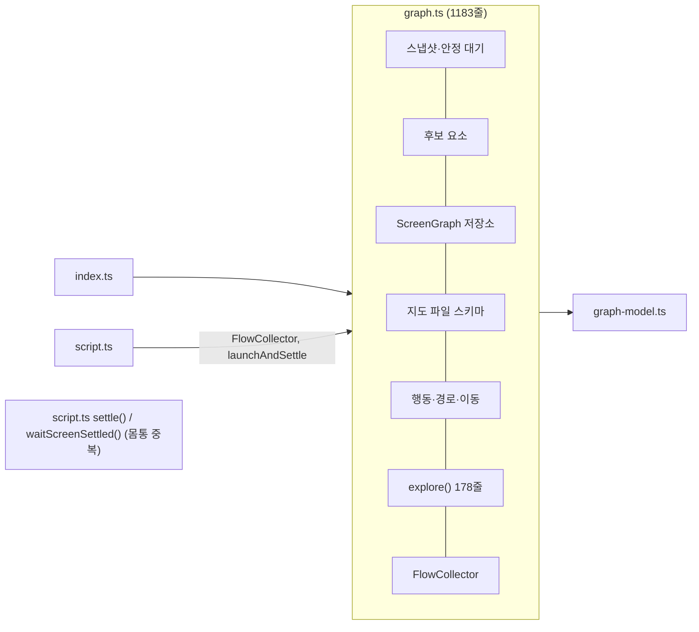
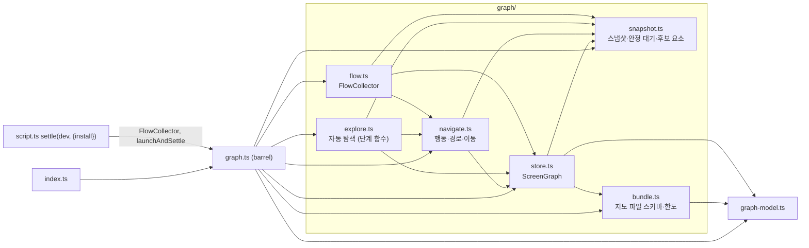

# 리팩토링: graph.ts 나누기 (2026-11-17)

이슈: [#68](https://github.com/ESeungJun/droidlens/issues/68) · 브랜치 `feature/68-split-graph` · 관련: [구현도](../구현도.md)

원칙: 밖에서 보이는 동작은 그대로 두고 구조만 바꾼다. `@droidlens/core`의 공개 export(값·타입), 지도 파일(`graph.json`·지도 bundle) 형식, MCP·데스크톱이 부르는 함수 모양은 바꾸지 않는다.

## 1. 왜 해야 하나

`packages/core/src/graph.ts`는 1183줄 한 파일에 서로 다른 이유로 바뀌는 일 다섯 가지를 함께 들고 있다.

| 줄(전) | 맡은 일 | 바뀌는 이유 |
|---|---|---|
| 35–158 | 스냅샷·안정 대기 (`captureSnapshot`, `waitForSettle`, `launchAndSettle`, `dismissSystemDialog`) | 기기·에이전트 타이밍 |
| 160–574 | 지도 저장소 `ScreenGraph` (열기·합치기·저장·초기화·내보내기·가져오기) | 저장 형식, 여러 프로세스 동시 쓰기 |
| 576–639 | 지도 파일 zod 스키마 | 공유 파일 검증 규칙 |
| 641–871 | 행동 실행·경로 계획·화면 이동 (`performAction`, `startTransition`, `followPath`, `planRoute`, `navigateTo`) | 경로 재생 정책 |
| 873–1101 | 자동 탐색 `explore()` (함수 하나 178줄, 클로저 4개) | 탐색 전략 |
| 1103–1183 | 흐름 수집 `FlowCollector` | 시나리오 실행과의 연결 |

지금의 비용
- 지도 저장만 고쳐도 탐색·이동이 같은 파일이라 리뷰 범위가 1183줄 전부다.
- `explore()`는 상태(`snap`, `steps`, `tried` 등)를 클로저로 나눠 쥐고 있어 한 갈래만 읽기 어렵다.
- 이 파일을 지키는 테스트가 없다 (`packages/core/test/*.test.mjs` 12개 중 graph·explore·planRoute 0개). 고치다 깨도 기기에서 직접 돌려 보기 전엔 모른다.
- `script.ts`의 `settle()`과 `waitScreenSettled()`는 에이전트를 얻는 방법만 다르고 몸통이 같다.

안 하면: 탐색·이동 기능을 더할수록 파일이 더 커지고, 테스트 없이 고치는 일이 반복된다.

## 2. 전·후 비교

| 항목 | 전 | 후 |
|---|---|---|
| 파일 | `graph.ts` 1183줄 1개 | `graph/` 6개 + `graph.ts` barrel |
| 가장 큰 파일 | 1183줄 | 500줄 이하 (`store.ts`) |
| 가장 긴 함수 | `explore()` 178줄 | 단계 함수로 나눠 50줄 안팎 |
| 의존 방향 | 파일 안에서 서로 아무 데나 | bundle·snapshot ← store ← navigate ← explore·flow (explore·flow는 snapshot·store도 직접 씀) (한 방향) |
| 공개 export | `index.ts` → `graph.ts` 전부 | 같은 이름·같은 타입 (barrel이 이름을 하나씩 내보냄, 내부 도우미는 숨김) |
| 테스트 | graph 관련 0개 | 순수 11개 + 가짜 기기 12개 (탐색 결과·명령 순서를 기준 파일로 고정) |
| settle 몸통 | `script.ts` 2곳 | 1곳 (`settle(dev, { install })`) |

### `graph.ts` 안의 `waitForSettle`은 왜 합치지 않나
이름은 비슷하지만 일이 다르다. `waitForSettle`은 덤프·스크린샷을 반복해 **안정된 스냅샷을 돌려주는** 함수(시간 한도 5초, 웹 화면 1초 유지)이고, `script.ts`의 `settle`은 조작 뒤 **잠깐 쉬기만** 한다(250ms idle / 2.5초, 반환값 없음). 하나로 합치면 대기 시간·기기 요청 수가 바뀌므로 합치지 않는다. `visual.ts:167`의 대기(500ms / 3초)도 스크린샷 비교용으로 값이 달라 그대로 둔다.

## 3. 전 설계도 / 후 설계도

전: 한 파일 안의 덩어리와 바깥 호출부

후: 한 방향 의존, `graph.ts`는 다시 내보내기만

## 4. 단계별 계획

단계마다 `pnpm -r typecheck` → `pnpm --filter @droidlens/core test` → 공개 export 목록 비교(`.work/exports.mjs`, TypeScript 검사기로 값·타입·모양을 뽑아 전과 diff) → 커밋. 커밋 하나가 되돌리기 지점이다.

1. **특성 테스트** (`test/graph.test.mjs`, `test/graph-device.test.mjs`, `test/fake-device.mjs`)
   - 순수: `candidateActions`·`targetAt`·`screenId`, `ScreenGraph` 기록·저장·다른 프로세스 기록 합치기·초기화·`saveSoon`/`flushAll`, 지도 내보내기→가져오기 왕복·거절 조건, `planRoute` 세 갈래.
   - 가짜 기기(에이전트 끔): `waitForSettle`, `launchAndSettle`, `dismissSystemDialog`, `performAction`, `recordTransition`/`startTransition` 취소, `followPath` 실패 네 가지, `navigateTo`, `explore` 세 가지 + 갈래 다섯 가지(리뷰 1회차 뒤 추가), `FlowCollector`.
   - `explore`·`navigateTo`는 결과와 **기기에 보낸 명령 순서**를 리팩토링 전 코드로 만든 `fixtures/graph-device.golden.json`과 비교한다.
2. `graph/snapshot.ts`: 스냅샷·안정 대기·시스템 대화상자·`screenId`·후보 요소(`candidateActions`, `targetAt`, `elementLabel`)
3. `graph/bundle.ts` + `graph/store.ts`: 지도 파일 스키마·`MAP_LIMITS`, `ScreenGraph`
4. `graph/navigate.ts`: `performAction`, `pressAction`, 전이 기록, `followPath`, `planRoute`, `navigateTo`
5. `graph/explore.ts`, `graph/flow.ts`, `graph.ts`를 barrel로 (내부 도우미는 내보내지 않음)
6. `explore()`를 단계 함수로: 시작 화면 잡기 / 건너뛸 행동 / 원래 화면 확인 / 행동 만들기 / 누르고 기다리기 / 돌아오기. 순서·대기·기기 요청은 그대로.
7. `script.ts`: `settle`·`waitScreenSettled` 몸통 합치기
8. `docs/구현도.md`를 후 기준으로, 이 문서에 실측 결과

## 5. 영향 범위

- 내부(바뀌는 파일): `packages/core/src/graph.ts`, 새 `packages/core/src/graph/*.ts` 6개, `packages/core/src/script.ts`(settle 두 함수), 테스트 3개 + 기준 파일 1개, `.gitignore`(테스트 홈 폴더), `docs/구현도.md`.
- 외부: `@droidlens/core` 공개 API 그대로. `packages/mcp`·`apps/desktop`은 `@droidlens/core`로만 가져오므로 수정 없음. `script.ts`는 `./graph.js`에서 가져오는 그대로.
- 데이터·설정: `~/.droidlens/graphs/<앱>/graph.json`·`graph.mmd`·지도 bundle 형식 그대로.

## 6. 리스크와 되돌리는 법

| 리스크 | 막는 법 |
|---|---|
| 옮기다 import 순서가 바뀌어 모듈 초기화 순서가 달라짐 | 모듈 최상위에서 하는 일은 상수·정규식·zod 스키마뿐. 순환 import 없음을 단계마다 확인 |
| 내부 도우미가 공개 export로 새어 나감 | barrel이 `export *` 대신 이름을 하나씩 내보내고, export 목록 diff가 비어야 커밋 |
| `explore()` 단계 분리에서 `continue`/`return` 의미가 바뀜 | 기준 파일(결과·진행 메시지·기기 명령 151개 순서)과 완전히 같아야 통과 |
| 에이전트 경로는 가짜 기기로 못 돎 | 에이전트 분기 코드는 줄 그대로 옮기기만 하고 고치지 않음. 미확인 항목으로 보고 |
| 기준 파일이 explore 의 오류·실패 갈래를 안 지나 단계 분리 실수를 못 잡음 (리뷰 1회차 돌연변이 14개 중 10개 생존) | 가짜 기기에 실패 버튼·BACK 실패·여러 화면 쌓기·같은 id 다른 배치를 더하고 갈래 시나리오 6개(앱 밖 경유 BACK·두 경로·웹 재대기·위치 갱신 / startAt+누름 실패 / relaunch:false BACK 무시·BACK 실패 / 시작 화면 재도달 / 취소)를 기준 파일에 추가. 기준은 리팩토링 전 graph.ts 빌드로 만듦. 돌연변이 14개 모두 잡힘 |
| 웹 화면 1.5초 재대기는 명령 순서가 같아 기준 파일로 안 보임 | 가짜 기기가 명령 받은 시각을 남기고, 웹 화면 누름 뒤 1.45초 넘게 비는지 본다 (하한만 보므로 느린 기계에서도 거짓 실패 없음) |

되돌리기: 단계 커밋을 `git revert`. 테스트 커밋(1단계)은 남겨 둬도 동작에 영향 없음.

## 7. 기대 효과 (측정할 것)

- 가장 큰 파일 줄 수: 1183 → 500 이하
- 가장 긴 함수 줄 수: 178 → 60 이하
- graph 관련 테스트: 0 → 23
- `script.ts` settle 몸통 중복: 2 → 1
- 빌드 시간(`pnpm --filter @droidlens/core build`)은 비슷해야 한다 (파일 수만 늘어남)

## 발견한 문제 (이번에 고치지 않음)

동작을 바꾸지 않는 리팩토링이라 고치지 않고 남긴다. 둘 다 사용자에게 보이는 증상은 없다.

1. `explore.ts` `returnTo`: BACK 두 번 루프의 `… && i === 1) break` 는 마지막 반복에서만 참이라 하는 일이 없다. 첫 BACK 뒤 앱 밖으로 나갔을 때 바로 그만두려던 것이라면 `i === 0` 이어야 한다. 의도를 확인하기 전엔 그대로 둔다.
2. `snapshot.ts` `orAbort`: 기다릴 때마다 signal 에 abort 리스너를 붙이고 떼지 않는다. 같은 signal 로 여러 번 기다리면(웹 화면 안정 대기 루프 등) signal 이 버려질 때까지 리스너가 쌓인다. signal 이 작업 하나 동안만 살아 있어 영향은 작다.

범위 밖 큰 덩어리(데스크톱 main IPC 78개, `script.ts` `runScript` 157줄·`runStep` 약 145줄·`evaluateAssertion` 134줄)는 백로그 [#69](https://github.com/ESeungJun/droidlens/issues/69).

## 실측 결과

| 항목 | 전 | 후 |
|---|---|---|
| `graph.ts` | 1183줄 | 37줄 (공개 입구) |
| `graph/` 파일 | 없음 | snapshot 198 · bundle 76 · store 430 · navigate 219 · explore 316 · flow 91 (합 1330) |
| 가장 큰 파일 | 1183줄 | 430줄 (`store.ts`) |
| 가장 긴 함수 | `explore()` 178줄 | 52줄 (`ScreenGraph.addSnapshot`·`importBundle`, 옮기기만 함). explore 쪽 가장 긴 메서드 `tryMove` 33줄 |
| 코드 줄 합계 | 1183 | 1367 (+184: 파일 머리 주석·import·클래스 필드 선언) |
| core 테스트 | 53개 | 84개 (graph 순수 12 · 가짜 기기 17 · settle 2) |
| `script.ts` settle 몸통 | 2곳 | 1곳 (871 → 872줄) |
| 공개 export (`index.ts`·`graph-model`·`scenario-view`) | 302개 | 302개, 이름·종류·타입 모양 diff 없음 |
| core 빌드 (`tsc`, 3회) | 2.93 / 2.94 / 3.10초 | 3.06 / 2.95 / 3.07초 |

- 원래 코드 줄이 빠지거나 바뀌지 않았는지: 원본 graph.ts 본문(import 제외)의 모든 비어 있지 않은 줄이 새 파일에 그대로 있는지 세어 확인했다. 다른 것은 구역 머리 주석 3줄과 `export` 를 붙인 내부 도우미 8개뿐이다 (explore 단계 나누기 전 기준).
- explore 단계 나누기 뒤에도 기준 파일(탐색 결과 · 진행 메시지 13개 · 기기 명령 151개 순서, relaunch:false 탐색 21개, navigateTo 23개)이 같다.
- 리뷰 1회차 뒤 갈래 기준 추가: `.work/review/mutate.py`·`mutate2.py` 의 explore 돌연변이 14개 중 잡힌 것 4개 → 14개. 새 기준 18개 키는 origin/develop 의 graph.ts 를 빌드한 사본(`.work/review/orig`)에서 `UPDATE_GOLDEN=1` 로 만들었고, 기존 7개 키는 그때 다시 만든 값과 같았다. HEAD 에서 같은 기준으로 통과한다.
- `waitScreenSettled` 의 install 갈래: 에이전트를 켠 가짜 기기에서 forward·shell 명령이 하나도 나가지 않는지 본다 (settle 쪽 `ensureAgent` 로 바꾸면 실패하는 것 확인).
- `importBundle` 스크린샷 이름에 `../` 를 넣어도 지도 폴더 밖에 파일이 생기지 않고 `safeName(id)-sha1 앞 8자.png` 로만 저장되는지 고정했다 (원본에서도 통과).
- 확인하지 못한 것: 에이전트가 있는 경로(`waitForSettle`·`launchAndSettle` 의 에이전트 분기, `FlowCollector.open`)는 가짜 기기로 돌지 않는다. 줄 그대로 옮기기만 했고 실기기·에뮬레이터 확인은 하지 않았다. explore 갈래 중 탐색 도중 크래시 대화상자(ANR 만 기준에 있음), `avoid`·`allowDanger: true`, 기다리는 도중의 취소(`orAbort`)는 기준 파일이 지나지 않는다. 웹 화면 1.5초 재대기는 시각 하한으로만 본다 (명령 순서로는 구분되지 않음).
