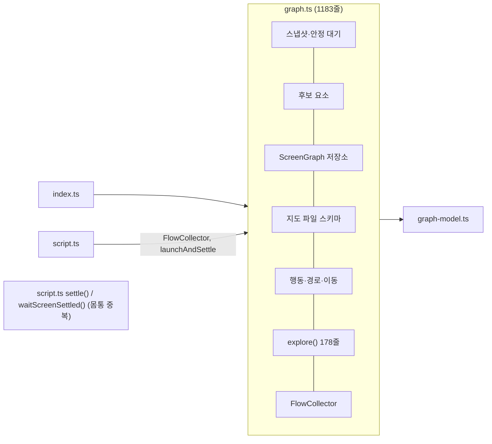
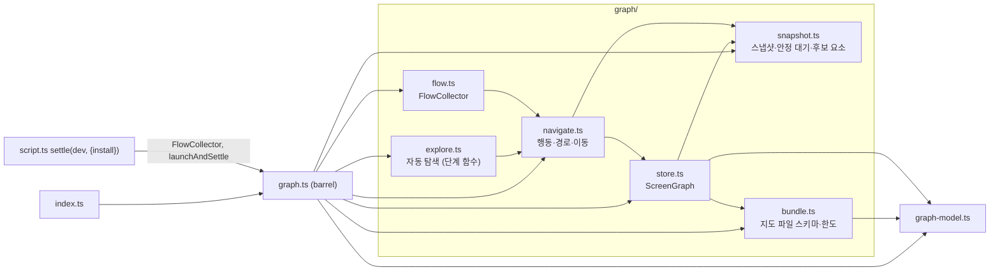

# 리팩토링: graph.ts 나누기 (2026-11-17)

이슈: [#68](https://github.com/ESeungJun/droidlens/issues/68) · 브랜치 `feature/68-split-graph` · 관련: [구현도](../구현도.md)

원칙: 밖에서 보이는 동작은 그대로 두고 구조만 바꾼다. `@droidlens/core`의 공개 export(값·타입), 지도 파일(`graph.json`·지도 bundle) 형식, MCP·데스크톱이 부르는 함수 모양은 바꾸지 않는다.

## 1. 왜 해야 하나

`packages/core/src/graph.ts`는 1183줄 한 파일에 서로 다른 이유로 바뀌는 일 다섯 가지를 함께 들고 있다.

| 줄(전) | 맡은 일 | 바뀌는 이유 |
|---|---|---|
| 35–158 | 스냅샷·안정 대기 (`captureSnapshot`, `waitForSettle`, `launchAndSettle`, `dismissSystemDialog`) | 기기·에이전트 타이밍 |
| 160–574 | 지도 저장소 `ScreenGraph` (열기·합치기·저장·초기화·내보내기·가져오기) | 저장 형식, 여러 프로세스 동시 쓰기 |
| 576–639 | 지도 파일 zod 스키마 | 공유 파일 검증 규칙 |
| 641–871 | 행동 실행·경로 계획·화면 이동 (`performAction`, `startTransition`, `followPath`, `planRoute`, `navigateTo`) | 경로 재생 정책 |
| 873–1101 | 자동 탐색 `explore()` (함수 하나 178줄, 클로저 4개) | 탐색 전략 |
| 1103–1183 | 흐름 수집 `FlowCollector` | 시나리오 실행과의 연결 |

지금의 비용
- 지도 저장만 고쳐도 탐색·이동이 같은 파일이라 리뷰 범위가 1183줄 전부다.
- `explore()`는 상태(`snap`, `steps`, `tried` 등)를 클로저로 나눠 쥐고 있어 한 갈래만 읽기 어렵다.
- 이 파일을 지키는 테스트가 없다 (`packages/core/test/*.test.mjs` 12개 중 graph·explore·planRoute 0개). 고치다 깨도 기기에서 직접 돌려 보기 전엔 모른다.
- `script.ts`의 `settle()`과 `waitScreenSettled()`는 에이전트를 얻는 방법만 다르고 몸통이 같다.

안 하면: 탐색·이동 기능을 더할수록 파일이 더 커지고, 테스트 없이 고치는 일이 반복된다.

## 2. 전·후 비교

| 항목 | 전 | 후 |
|---|---|---|
| 파일 | `graph.ts` 1183줄 1개 | `graph/` 6개 + `graph.ts` barrel |
| 가장 큰 파일 | 1183줄 | 500줄 이하 (`store.ts`) |
| 가장 긴 함수 | `explore()` 178줄 | 단계 함수로 나눠 50줄 안팎 |
| 의존 방향 | 파일 안에서 서로 아무 데나 | snapshot ← bundle·store ← navigate ← explore·flow (한 방향) |
| 공개 export | `index.ts` → `graph.ts` 전부 | 같은 이름·같은 타입 (barrel이 이름을 하나씩 내보냄, 내부 도우미는 숨김) |
| 테스트 | graph 관련 0개 | 순수 11개 + 가짜 기기 12개 (탐색 결과·명령 순서를 기준 파일로 고정) |
| settle 몸통 | `script.ts` 2곳 | 1곳 (`settle(dev, { install })`) |

### `graph.ts` 안의 `waitForSettle`은 왜 합치지 않나
이름은 비슷하지만 일이 다르다. `waitForSettle`은 덤프·스크린샷을 반복해 **안정된 스냅샷을 돌려주는** 함수(시간 한도 5초, 웹 화면 1초 유지)이고, `script.ts`의 `settle`은 조작 뒤 **잠깐 쉬기만** 한다(250ms idle / 2.5초, 반환값 없음). 하나로 합치면 대기 시간·기기 요청 수가 바뀌므로 합치지 않는다. `visual.ts:167`의 대기(500ms / 3초)도 스크린샷 비교용으로 값이 달라 그대로 둔다.

## 3. 전 설계도 / 후 설계도

전: 한 파일 안의 덩어리와 바깥 호출부

후: 한 방향 의존, `graph.ts`는 다시 내보내기만

## 4. 단계별 계획

단계마다 `pnpm -r typecheck` → `pnpm --filter @droidlens/core test` → 공개 export 목록 비교(`.work/exports.mjs`, TypeScript 검사기로 값·타입·모양을 뽑아 전과 diff) → 커밋. 커밋 하나가 되돌리기 지점이다.

1. **특성 테스트** (`test/graph.test.mjs`, `test/graph-device.test.mjs`, `test/fake-device.mjs`)
   - 순수: `candidateActions`·`targetAt`·`screenId`, `ScreenGraph` 기록·저장·다른 프로세스 기록 합치기·초기화·`saveSoon`/`flushAll`, 지도 내보내기→가져오기 왕복·거절 조건, `planRoute` 세 갈래.
   - 가짜 기기(에이전트 끔): `waitForSettle`, `launchAndSettle`, `dismissSystemDialog`, `performAction`, `recordTransition`/`startTransition` 취소, `followPath` 실패 네 가지, `navigateTo`, `explore` 세 가지, `FlowCollector`.
   - `explore`·`navigateTo`는 결과와 **기기에 보낸 명령 순서**를 리팩토링 전 코드로 만든 `fixtures/graph-device.golden.json`과 비교한다.
2. `graph/snapshot.ts`: 스냅샷·안정 대기·시스템 대화상자·`screenId`·후보 요소(`candidateActions`, `targetAt`, `elementLabel`)
3. `graph/bundle.ts` + `graph/store.ts`: 지도 파일 스키마·`MAP_LIMITS`, `ScreenGraph`
4. `graph/navigate.ts`: `performAction`, `pressAction`, 전이 기록, `followPath`, `planRoute`, `navigateTo`
5. `graph/explore.ts`, `graph/flow.ts`, `graph.ts`를 barrel로 (내부 도우미는 내보내지 않음)
6. `explore()`를 단계 함수로: 시작 화면 잡기 / 건너뛸 행동 / 원래 화면 확인 / 행동 만들기 / 누르고 기다리기 / 돌아오기. 순서·대기·기기 요청은 그대로.
7. `script.ts`: `settle`·`waitScreenSettled` 몸통 합치기
8. `docs/구현도.md`를 후 기준으로, 이 문서에 실측 결과

## 5. 영향 범위

- 내부(바뀌는 파일): `packages/core/src/graph.ts`, 새 `packages/core/src/graph/*.ts` 6개, `packages/core/src/script.ts`(settle 두 함수), 테스트 3개 + 기준 파일 1개, `.gitignore`(테스트 홈 폴더), `docs/구현도.md`.
- 외부: `@droidlens/core` 공개 API 그대로. `packages/mcp`·`apps/desktop`은 `@droidlens/core`로만 가져오므로 수정 없음. `script.ts`는 `./graph.js`에서 가져오는 그대로.
- 데이터·설정: `~/.droidlens/graphs/<앱>/graph.json`·`graph.mmd`·지도 bundle 형식 그대로.

## 6. 리스크와 되돌리는 법

| 리스크 | 막는 법 |
|---|---|
| 옮기다 import 순서가 바뀌어 모듈 초기화 순서가 달라짐 | 모듈 최상위에서 하는 일은 상수·정규식·zod 스키마뿐. 순환 import 없음을 단계마다 확인 |
| 내부 도우미가 공개 export로 새어 나감 | barrel이 `export *` 대신 이름을 하나씩 내보내고, export 목록 diff가 비어야 커밋 |
| `explore()` 단계 분리에서 `continue`/`return` 의미가 바뀜 | 기준 파일(결과·진행 메시지·기기 명령 151개 순서)과 완전히 같아야 통과 |
| 에이전트 경로는 가짜 기기로 못 돎 | 에이전트 분기 코드는 줄 그대로 옮기기만 하고 고치지 않음. 미확인 항목으로 보고 |

되돌리기: 단계 커밋을 `git revert`. 테스트 커밋(1단계)은 남겨 둬도 동작에 영향 없음.

## 7. 기대 효과 (측정할 것)

- 가장 큰 파일 줄 수: 1183 → 500 이하
- 가장 긴 함수 줄 수: 178 → 60 이하
- graph 관련 테스트: 0 → 23
- `script.ts` settle 몸통 중복: 2 → 1
- 빌드 시간(`pnpm --filter @droidlens/core build`)은 비슷해야 한다 (파일 수만 늘어남)

## 발견한 문제 (이번에 고치지 않음)

(작업하며 채운다)

## 실측 결과

(끝나고 채운다)
