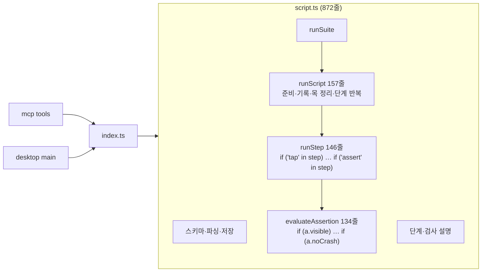
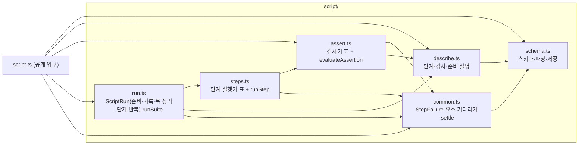
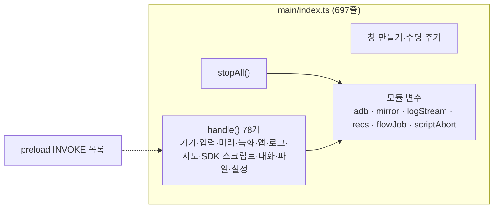
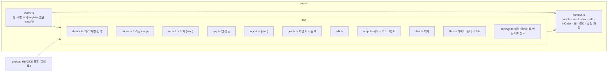

# 리팩토링: script.ts 단계 실행기와 데스크톱 IPC 나누기 (2026-11-19)

이슈: [#69](https://github.com/ESeungJun/droidlens/issues/69) · 브랜치 `feature/69-split-ipc-script` · 앞 작업: [graph.ts 나누기](2026-11-17_graph-분리.md) · 관련: [구현도](../구현도.md)

원칙: 밖에서 보이는 동작은 그대로 두고 구조만 바꾼다.
- `@droidlens/core` 공개 export(값·타입) 그대로
- 시나리오 스크립트 YAML 형식, 리포트 단계(제목·상태·근거·검사 칸) 그대로
- 데스크톱 IPC 채널 이름·인자·돌려주는 모양, preload 가 여는 채널 목록 그대로

## 1. 왜 해야 하나

| 파일 | 지금 | 문제 |
|---|---|---|
| `packages/core/src/script.ts` | 872줄. `runScript` 157줄 · `runStep` 146줄 · `evaluateAssertion` 134줄 | 단계 종류마다 `if ('x' in step)` 가 한 함수에 이어지고, 검사 종류마다 `if (a.x)` 가 또 한 함수에 이어진다. 단계 하나를 더하려면 세 함수(스키마·실행·설명)를 위아래로 오가야 한다 |
| `apps/desktop/src/main/index.ts` | 697줄. IPC 채널 78개를 한 파일에서 `handle('…')` | 기기·화면·미러·녹화·로그·지도·SDK·시나리오·대화·설정이 섞여 있어 채널 하나를 고쳐도 파일 전체를 읽는다. 종료 정리(`stopAll`)가 여러 기능의 상태 변수를 직접 만진다 |

테스트: `script.ts` 는 파싱 쪽만 MCP 테스트에서 지나가고 실행(`runScript`)을 지키는 테스트가 없다. 데스크톱 main 은 테스트가 없다.

안 하면: 다음 기능(문서에서 TC 를 뽑아 시나리오로 돌리는 QA 기능)이 스크립트 실행·IPC 에 단계와 채널을 더하는데, 지금 구조에선 두 파일이 더 커진다.

## 2. 전·후 비교

| 항목 | 전 | 후 |
|---|---|---|
| `script.ts` | 872줄 1개 | `script/` 나눔 + `script.ts` 공개 입구 |
| 가장 긴 함수 (script) | `runScript` 157줄 | 60줄 이하 |
| 단계 실행 | `runStep` 안 `if` 13갈래 | 단계 종류 → 실행기 표. `runStep` 은 고르기만 |
| 검사 | `evaluateAssertion` 안 `if` 10갈래 | 검사 종류 → 검사기 표 (순서 그대로) |
| 데스크톱 main | `index.ts` 697줄 | `index.ts` 는 창·수명 주기·등록만, 채널은 `ipc/<기능>.ts` |
| 종료 정리 | `stopAll` 이 미러·로그·녹화 변수를 직접 만짐 | 기능 파일이 `stop()` 을 내보내고 `stopAll` 은 부르기만 |
| 테스트 | 실행 0개 | 가짜 기기 + 가짜 SDK 로 `runScript`·`evaluateAssertion`·`runSuite` 13개 (결과·리포트 단계·기기 명령·SDK 요청 순서를 기준 파일로 고정) |

## 3. 전 설계도 / 후 설계도

### script.ts

전

후

의존 방향: schema ← describe·common ← assert ← steps ← run. 거꾸로 가는 import 는 없다.

### 데스크톱 main

전

후

## 4. 단계별 계획

단계마다 `pnpm build` → `pnpm typecheck` → `pnpm test` → 공개 export 목록 비교(`.work/exports.mjs`, 302개) → 커밋.

1. **특성 테스트** (`packages/core/test/script-run.test.mjs`, 기준 `fixtures/script-run.golden.json`)
   - 가짜 기기(`fake-device.mjs`)에 기기 시계·SDK 소켓·pm clear·시작 시간·성능 표본·logcat crash 응답을 더하고, 가짜 SDK 는 로컬 HTTP 서버로 띄운다.
   - 조작 단계 전부 통과 / 첫 실패 중단 / continueOnFail 로 실패·건너뜀 갈래 / 성능(앱 없음) / 준비(clearData·prefs·mocks) + SDK 검사 통과·실패 / 목을 못 지움 / 준비 실패(blocked) / 중단 신호 / guardDanger / 크래시 / 스크린샷 비교(저장·통과·실패) / `evaluateAssertion` 직접 / `runSuite`.
   - 기준은 리팩토링 전 코드로 만든다. 시간 한도까지 되풀이하는 대기 루프는 횟수가 기계마다 달라, 바로 이어 되풀이되는 명령 묶음(1~4개)을 하나로 줄여 비교한다.
2. **script/ 나누기**: 스키마 → 설명 → 공통 → 검사기 표 → 단계 실행기 표 → `ScriptRun` 클래스 순. 실행기를 고르는 순서는 지금 `if` 순서를 그대로 쓴다 (검증을 거치지 않은 단계 객체에 키가 둘 있어도 같은 쪽이 고른다).
3. **desktop main 나누기**: `context.ts` 로 공용(핸들러 감싸기·보내기·기기·입력 순서·경로·설정 파일)을 빼고 기능별 `ipc/*.ts` 로 옮긴다. 채널 목록을 `.work/channels.mjs` 로 전·후 비교한다 (78개, preload 와의 차이 `hierarchy` 하나 — 화면에서 안 쓰는 채널, 전부터 그랬다).
4. `docs/구현도.md` 를 후 기준으로, 이 문서에 실측 결과.

## 5. 영향 범위

- 내부(바뀌는 파일): `packages/core/src/script.ts`, 새 `packages/core/src/script/*.ts`, `apps/desktop/src/main/index.ts`, 새 `apps/desktop/src/main/context.ts`·`ipc/*.ts`, 테스트 1개 + 기준 파일 1개, `docs/구현도.md`.
- 외부: `@droidlens/core` 공개 API 그대로. `report-junit.ts` 가 `./script.js` 에서 `SuiteResult` 타입을 가져오는 그대로. MCP 는 `@droidlens/core` 로만 가져오므로 수정 없음. 렌더러·preload 수정 없음.
- 데이터·설정: 스크립트 YAML, 시나리오 리포트(`scenario.json`), `~/.droidlens/config.json` 형식 그대로.

## 6. 리스크와 되돌리는 법

| 리스크 | 막는 법 |
|---|---|
| 실행기 표로 바꾸며 단계 고르는 순서가 달라짐 | 지금 `if` 순서를 배열로 두고 그 순서로 찾는다 |
| 검사 순서·근거 문자열이 달라짐 | 검사기 표를 지금 `if` 순서대로 두고, 기준 파일이 근거·실패 문구를 글자 그대로 비교 |
| `runScript` 를 클래스로 옮기며 기록·목 정리 순서가 바뀜 | 기준 파일이 리포트 단계 순서·기기 명령·SDK 요청 순서를 비교 (목 지우기 실패 갈래 포함) |
| IPC 채널을 옮기다 빠뜨리거나 두 번 등록 | `.work/channels.mjs` 로 전·후 78개 목록이 같고 중복이 없는지 확인. `ipcMain.handle` 은 같은 채널을 두 번 등록하면 시작할 때 예외라 바로 드러난다 |
| `setAdbPath` 가 `adb` 를 바꿔 끼우는데 다른 파일이 옛 값을 쥠 | `adb` 를 변수로 내보내지 않고 `context.ts` 의 `adb()`·`dev()` 함수로만 읽는다 |
| 데스크톱은 자동 테스트가 없음 | `electron-vite build` 와 typecheck 로 확인. 실행 확인은 `DROIDLENS_SNAPSHOT` 으로 창을 띄워 첫 화면 캡처까지 (기기 조작은 미확인으로 보고) |

되돌리기: 단계 커밋을 `git revert`. 테스트 커밋(1단계)은 남겨 둬도 동작에 영향 없음.

## 7. 기대 효과 (측정할 것)

- script 쪽 가장 긴 함수: 157 → 60 이하
- desktop `index.ts`: 697 → 200 이하
- 스크립트 실행 테스트: 0 → 13
- 공개 export 302개, IPC 채널 78개 그대로
