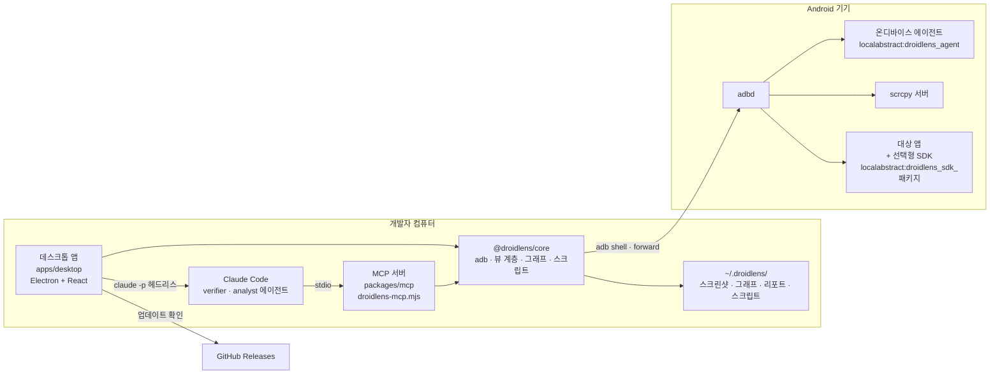

# DroidLens 설계서

> 2026-11-05에 v0.10.4 코드와 git 히스토리에서 복원했다.

관련 문서: [기획서](기획서.md) · [구현도](구현도.md) · [결정기록](결정기록.md) · [로드맵](ROADMAP.md)

## 기술 스택과 고른 이유

| 영역 | 고른 것 | 이유 (근거) |
|---|---|---|
| 기기 연결 | adb (`packages/core/src/adb.ts`) | SDK 없이 어떤 앱이든 보려면 adb가 기본이어야 한다(개발 글) |
| 빠른 화면 읽기 | 온디바이스 에이전트 APK(Java, Instrumentation + UiAutomation, 13KB) | `uiautomator dump` 1.5~3초, Activity 확인 1~7초는 에이전트에게 너무 느렸다. 에이전트로 0.03~0.3초(`591a14e`) |
| 미러링 | scrcpy v5 서버 + WebCodecs H.264 | 고프레임(최대 60fps). 서버는 받을 때 SHA256 검증(`87cb6a7`) |
| 앱 내부 정보 | 선택형 Android SDK(Java) + `sdk-noop` | 네트워크·DB·Prefs는 adb로 못 본다. debug 빌드에만 넣고 release엔 빈 구현(개발 글) |
| 공용 엔진 | TypeScript `@droidlens/core` | 데스크톱과 MCP가 같은 엔진을 쓴다 |
| 에이전트 연동 | MCP 서버(`@droidlens/mcp`, stdio, 단일 파일 번들) | Claude Code가 같은 기능을 도구로 쓴다. 앱에 내장해 Node 설치 없이 등록 |
| 데스크톱 | Electron 44 + React 19 + electron-vite, `@xyflow/react`(흐름 그래프), dagre | 기록 없음. 크로스 플랫폼 설치 파일을 한 설정으로 만든다 |
| 모노레포 | pnpm 워크스페이스 | core·mcp·desktop을 같이 빌드 |
| 패키징·배포 | electron-builder, GitHub Actions(`release.yml`), GitHub Releases | `v*` 태그 푸시로 세 OS 빌드 |
| 업데이트 | 직접 구현(`apps/desktop/src/main/updater.ts`, `delta.ts`) | 처음엔 서명 없는 앱이라 Squirrel 대신 직접 번들 교체(`8225356`). 이후 blockmap으로 달라진 조각만 받기(`d73862d`) |

후보를 나란히 비교한 기록(예: Tauri와 비교)은 남아 있지 않다. 개발 글의 결정표만 있다.

| 목표 | 결정 | 이유 |
|---|---|---|
| SDK 없이 어떤 앱이든 | adb를 기본으로, SDK는 선택으로 | 남의 앱이나 release 빌드도 봐야 해서 |
| 에이전트가 직접 검증 | 기기 안에 에이전트 APK | 화면을 수십 번 읽는 에이전트에게 3초는 너무 길어서 |
| | 검증 과정을 YAML로 저장 | 한 번 검증한 걸 회귀 테스트로 쌓으려고 |
| 누구나 시작할 수 있게 | 헷갈리는 옵션 제거, 기기 연결 도우미 | 만든 사람도 헷갈리면 쓰는 사람은 더 헷갈려서 |
| 혼자서도 계속 굴러가게 | 한 줄 설치 스크립트, 업데이트 직접 구현 | 릴리스만 올리면 설치·업데이트가 알아서 되게 |

출처: `dev-post/03-droidlens/tables/tables.html`.

## 전체 아키텍처

- core가 모든 기기 작업을 맡고, 데스크톱과 MCP는 그 위의 두 얼굴이다.
- 에이전트·SDK와는 `adb forward`로 연 로컬 포트를 거쳐 HTTP로 이야기한다(`packages/core/src/http.ts`).
- 에이전트가 없거나 실패하면 uiautomator·dumpsys로 자동으로 돌아간다.

## 데이터 구조·저장소·외부 API

### 산출물 (`~/.droidlens/`, `DROIDLENS_HOME`으로 변경)

| 폴더 | 내용 |
|---|---|
| `screenshots/`, `recordings/` | 스크린샷 PNG, 녹화 mp4 |
| `graphs/<패키지>/` | 화면 지도 `graph.json`, `graph.mmd`(mermaid), 화면별 스크린샷 |
| `scenarios/<id>/` | `report.html`, `scenario.json`, 녹화된 `script.yaml`, 단계별 스크린샷 |
| `scripts/` | 회귀 테스트 YAML |
| `apks/<패키지>/` | 분석용 APK |
| `agent/` | 에이전트 APK 사본 |
| `update.log` | macOS 업데이트 교체 로그 |

- 화면 지도 내보내기 파일: `*.droidlens-map.json`(스크린샷 포함 한 파일).
- 화면 식별: 뷰 계층의 구조 시그니처. 스크롤 영역 안의 내용은 빼서 목록이 바뀌어도 같은 화면으로 본다(`ba5cfa4`).

### 기기 쪽 통신

| 상대 | 주소 | 접근 제한 |
|---|---|---|
| 에이전트 | `localabstract:droidlens_agent` | 접속 UID가 shell·root일 때만. INTERNET 권한 없음 |
| SDK | `localabstract:droidlens_sdk_<패키지>` | shell·root·앱 자신만. 본문은 1MB 제한 |
| scrcpy | forward 터널 | scrcpy 프로토콜 |

### SDK 데이터

- 네트워크 기록: 요청·응답 본문 각 256KB까지, 최근 500건, 메모리에만, 전체 32MB 상한(v0.9.0).
- 민감 정보는 기기 안에서 저장하기 전에 가린다(`Redactor.java`): 헤더, 쿼리, 리다이렉트, JSON(중첩·문자열 안 JSON), GraphQL 인자, 폼·multipart·XML, 오류 메시지, 이벤트.
- 네트워크 목 규칙은 앱 내부 저장소에 남아 재시작 뒤에도 적용된다.

### 외부 API

| 대상 | 용도 |
|---|---|
| GitHub Releases API | 최신 버전 확인(시작 시 + 6시간마다), 설치 파일·blockmap·SHA256SUMS |
| scrcpy GitHub 릴리스 | 빌드 시 서버 내려받기(SHA256 검증) |
| JitPack | SDK 배포 |

## 플랫폼별 차이

| 항목 | macOS | Windows | Linux |
|---|---|---|---|
| 설치 파일 | dmg·zip(arm64·x64) | NSIS exe(x64·arm64) | AppImage(x86_64) |
| 한 줄 설치 | `/Applications`에 설치·교체 | 없음 | `~/.local/bin`에 AppImage |
| 서명 | Developer ID + 공증(v0.8.4~) | 없음(SmartScreen 안내) | 없음 |
| 업데이트 | zip 받아 앱 종료 뒤 번들 교체, 실패 시 복구, 로그 `~/.droidlens/update.log` | NSIS 조용히 실행(`/S --force-run`) | AppImage 교체 |
| 조각 업데이트 이전 파일 | 지난번 받은 설치 파일(`update-cache`) | 지난번 받은 설치 파일 | 실행 중인 AppImage |
| 대화창 claude 호출 | 그대로 | cmd.exe 인용 처리(JSON·여러 줄 인자 깨짐 수정, `45e5ff5`) | 그대로 |

## 보안·권한

- 에이전트는 Appium·uiautomator와 같은 Instrumentation 권한으로 동작한다. 처음엔 TCP 127.0.0.1:7912를 열어 같은 기기의 다른 앱이 UiAutomation 권한을 빌려 쓸 수 있었다 → 유닉스 소켓 + UID 검사로 바꿨다(`f0c4abf`).
- 에이전트·SDK 소켓을 다른 앱이 먼저 열면 연결하지 않는다. 소켓 주인은 프로세스 이름이 아니라 uid로 확인한다(`71b19d0`, `2204ddc`).
- 셸로 넘기는 값(패키지 이름, 녹화 크기 등)은 검증한다(`f0c4abf`, `909984d`).
- Electron: sandbox, 새 창·외부 이동 차단, 파일 IPC 경로를 데이터 폴더로 제한, preload는 필요한 채널만 연다(`d22fb97`), CSP.
- 대화창은 `--strict-mcp-config` + `--allowedTools`로 DroidLens 도구만 쓰게 한다(`apps/desktop/src/main/chat.ts`).
- MCP 스크립트 도구는 scripts 폴더 안만 읽고 쓴다. 심볼릭 링크로 밖에 나가지 못한다(`45368d6`, `64780c8`, `252ace0`).
- 위험 버튼(결제·삭제·로그아웃·전송)은 자동 탐색·경로 재생·MCP `tap`·MCP `script_run`/`suite_run` 모두 기본으로 누르지 않는다. 사용자가 직접 시킨 경우만 `allowDanger: true`(`7583fe8`).
  - 스크립트 실행기는 `guardDanger` 옵션이 켜져 있으면 `tap`·`longPress`·`tapAt` 단계마다 누르기 직전에 그 좌표에서 실제로 반응할 요소를 찾아 같은 라벨 검사를 한다. 검사가 '어떤 도구로 눌렀나'가 아니라 '무엇이 눌리나'를 따라가게 하려는 것이다. MCP에서만 켜고, 사람이 데스크톱·CLI에서 돌릴 때는 끈다.
- 시나리오 리포트(HTML·`scenario.json`)는 팀에 공유될 수 있어 조작 로그의 값을 기본으로 가린다. 입력값은 비밀번호·인증·카드·연락처 칸이 아니라고 확인될 때만 보이고, 딥링크·목 URL은 쿼리·fragment·토큰 경로를, DB 쓰기는 리터럴을, Prefs는 비밀 같은 키·값을 가린다(`packages/core/src/redact.ts`). 재실행용 `script.yaml`에는 원문이 남는다.
- 설치 스크립트·업데이터는 받은 파일을 SHA256SUMS로 확인한다(`f597c6f`).
- 릴리스 워크플로는 의존성 설치 스크립트를 돌리지 않고(`--ignore-scripts`), 서명 인증서·공증 키는 macOS 패키징 단계에만 넘긴다.
- 공개 저장소라 회사 앱 이름·개인 경로를 커밋하지 않는다(프로젝트 메모리).

## 알려진 한계

- 네트워크·DB·Prefs는 SDK를 넣은 debug 빌드에서만, 네트워크는 OkHttp(Retrofit 포함)만.
- WebView·Flutter·게임 엔진 화면은 접근성 노드가 적어 분석이 제한된다.
- Appium 등 다른 UiAutomation 도구와 동시에 못 쓴다.
- Windows·Linux 설치 파일은 서명이 없다.
- 개발 중 Mac이 Intel이고 부하가 커서 에뮬레이터 성능 수치는 해석에 주의한다(프로젝트 메모리).
